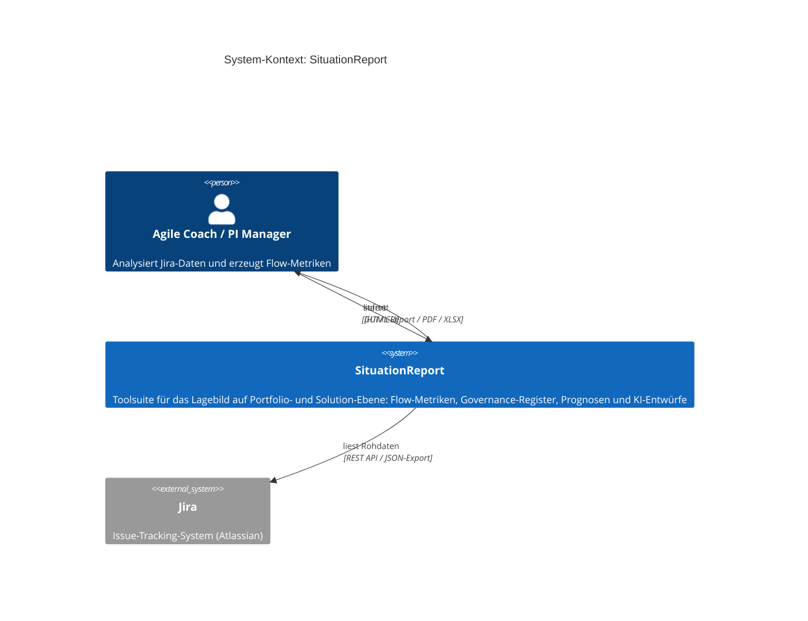
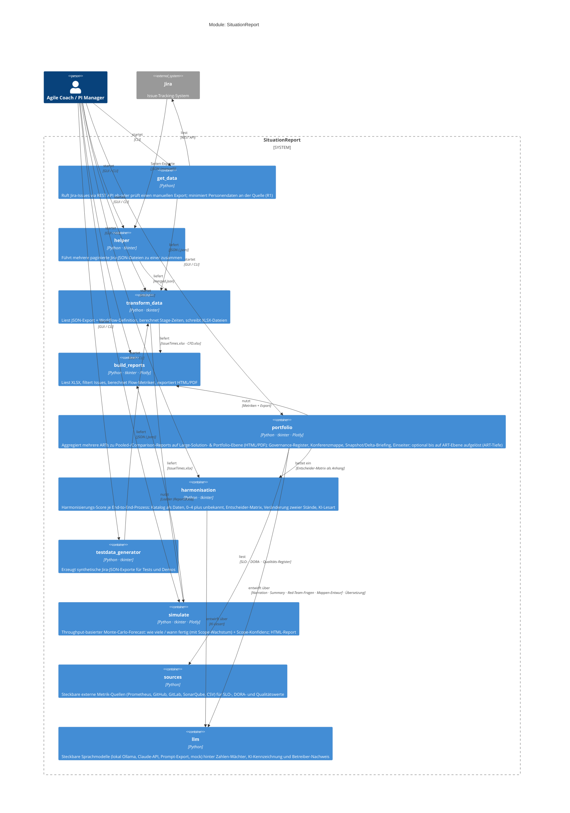
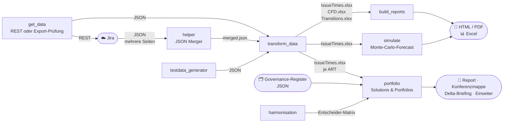
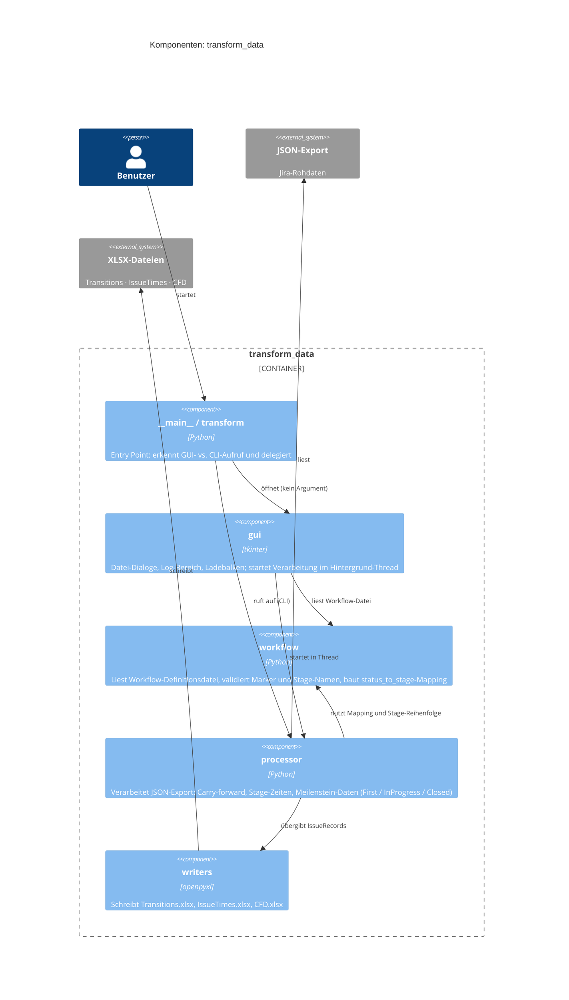
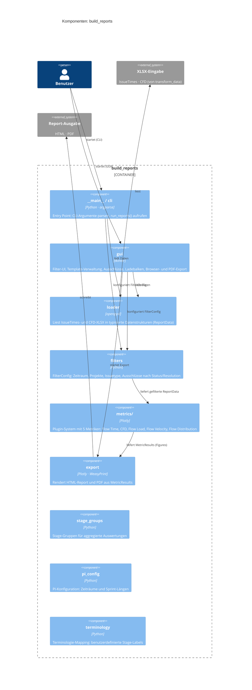
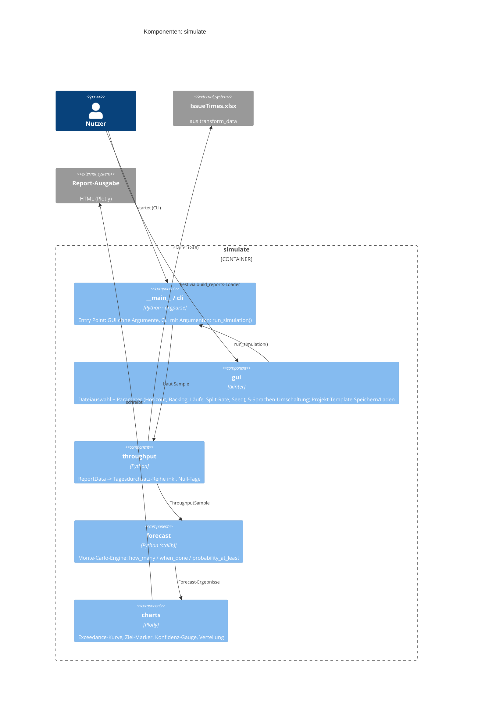
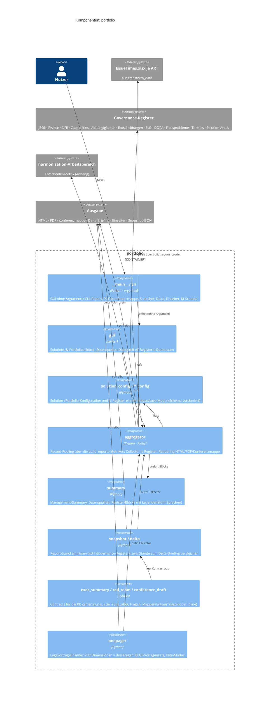

# Architektur

SituationReport folgt dem **C4-Modell** (Simon Brown): Kontext → Module → Komponenten.
Die Diagramme zeigen drei Detailstufen — von der Vogelperspektive bis auf Dateiebene.

---

## Level 1 — System-Kontext

Wer benutzt das System und mit welchen externen Systemen interagiert es?

---

## Level 2 — Module (Container)

Welche Module gibt es, welche Technologien nutzen sie und wie fließen Daten?

### Datenfluss

---

## Level 3 — Komponenten: transform_data

| Datei | Verantwortung |
|-------|--------------|
| `__main__.py` / `transform.py` | Entry Point; erkennt GUI- vs. CLI-Modus |
| `gui.py` | tkinter-Oberfläche; Background-Thread; Ladebalken nach 3 s |
| `workflow.py` | Workflow-Definitionsdatei lesen, validieren, Mapping aufbauen |
| `processor.py` | Jira-JSON verarbeiten; Stage-Zeiten, Carry-forward, Meilenstein-Fallbacks |
| `writers.py` | XLSX-Ausgabe (Transitions, IssueTimes, CFD) |

---

## Level 3 — Komponenten: build_reports

| Datei / Verzeichnis | Verantwortung |
|--------------------|--------------|
| `__main__.py` / `cli.py` | Entry Point; argparse; `run_reports()` |
| `gui.py` | tkinter-Oberfläche; Templates; Ausschlüsse; Ladebalken; Browser-/PDF-Export |
| `loader.py` | XLSX einlesen → `ReportData` (typisierte Dataclasses) |
| `filters.py` | `FilterConfig`; `apply_filters()`; Ausschluss-Logik |
| `metrics/base.py` | Abstrakte `MetricPlugin`-Klasse + `MetricResult`-Container |
| `metrics/*.py` | Konkrete Metriken: `flow_time`, `cfd`, `flow_load`, `flow_velocity`, `flow_distribution` |
| `export.py` | HTML-Rendering; PDF-Export via WeasyPrint |
| `stage_groups.py` | Stage-Gruppen-Definition |
| `pi_config.py` | PI-Zeiträume, Sprint-Längen |
| `terminology.py` | Benutzerdefinierte Terminologie |

---

## Level 3 — Komponenten: simulate

| Datei | Verantwortung |
|------|---------------|
| `__main__.py` / `cli.py` | Entry Point; argparse; `run_simulation()` |
| `gui.py` | tkinter-Oberfläche (5 Sprachen per Flaggen-Umschalter); Parameter; Projekt-Template Speichern/Laden (`project_template`, `MODULE_SIMULATE`); HTML-Report + Browser |
| `throughput.py` | `ReportData` → Tagesdurchsatz-Reihe (inkl. Null-Tage) |
| `forecast.py` | Monte-Carlo-Engine: `how_many`, `when_done` (Scope-Wachstum), `probability_at_least` |
| `charts.py` | Plotly: Exceedance-Kurve, Ziel-Marker, Konfidenz-Gauge, Termin-Verteilung |

Reine Standardbibliothek (`random`, `bisect`, `statistics`) — kein numpy/pandas —
für maximale Portabilität; nutzt `build_reports.loader` zum Einlesen der Eingabe.

---

## Level 3 — Komponenten: portfolio

| Datei | Verantwortung |
|-------|---------------|
| `__main__.py` / `cli.py` | Einstieg; argparse; `--pdf`, `--conference`, `--snapshot`, `--delta`, `--onepager`, `--kata`, KI-Schalter |
| `gui.py` | Solutions-&-Portfolios-GUI; Datenquellen-Dialog (elf Register-Pfade); Templates; Datenraum |
| `solution_config.py` | Solution-/Portfolio-Konfiguration (Mitglieder, Modus, Stage-Map, Register-Pfade, Konferenztermin) |
| `*_config.py` | Je Register ein Modul: ROAM-Risiken, NFR/Runway, Capabilities, Abhängigkeiten, Entscheidungen, SLO, DORA, Flussprobleme, Themes, Solution Areas |
| `aggregator.py` | Record-Pooling; Collector; HTML-Report, PDF-Seiten, Konferenzmappe (vier Inputs + Anhang) |
| `summary.py` | Management-Summary, Datenqualitäts-Flag, Register-Tabellen und -Figuren, Legenden |
| `decision_point.py` | Cross-Value-Stream-Druck und Entscheidungspunkt-Wecker (P4) |
| `snapshot.py` / `delta.py` | Report-Snapshot (acht Governance-Register) und Delta-Briefing |
| `exec_summary.py` / `red_team.py` / `conference_draft.py` | KI-Contracts (D1, D5, D8) — Zahlen kommen aus dem Snapshot, nie aus dem Modell |
| `onepager.py` | Einseiter (P6): deterministische Lesung derselben Collector; nur Entscheidungspunkte, keine Empfehlungen |
| `briefing.py` | Lagevortrag-Entwurf (M6): die Zellen des Einseiters als zitierbare Fakten `E/…` plus Fakten-Index; bewacht wie D3/D4; eigene Datei, Seite bleibt KI-frei |
| `report_texts.py` | Alle Report-Texte in fünf Sprachen |

---

## Level 3 — Komponenten: harmonisation

| Datei | Verantwortung |
|-------|---------------|
| `__main__.py` / `cli.py` | GUI ohne Argumente; CLI: Report, `--since`/`--delta`, `--narrate` |
| `model.py` | Arbeitsbereich (Katalog, Prozesse, Bewertungen, Entscheidungen) mit Schema-Prüfung |
| `score.py` | Score-Arithmetik: 0–4 plus „unbekannt“, Beleggrad → Konfidenz, Median und Spanne |
| `delta.py` | Veränderung zweier Stände (`filter_as_of`, `compute_delta`) |
| `reading.py` | KI-Lesart: Contract ohne Personen, Prompt untersagt Empfehlungen, Rückgabewert 3 ohne Entwurf |
| `render.py` | Entscheider-Matrix, Delta-HTML, Matrix-Block für die Konferenzmappe des Portfolios |
| `gui.py` | tkinter-Editor und Report-Dialog (fünf Sprachen) |

---

## Level 3 — Komponenten: llm

| Datei | Verantwortung |
|-------|---------------|
| `base.py` | Provider-Protokoll, `LlmResult`, Betriebsklassen (lokal · entfernt · Export · Attrappe) |
| `providers/*.py` | Backends: `ollama` (lokal), `claude` (API), `export` (schreibt das Prompt-Paket statt ein Modell zu rufen), `mock` |
| `narrate.py` | Ein Einstieg für jeden KI-Zweck: Contract rein, Entwurf raus, Wächter angewandt |
| `guard.py` | Zahlen-Wächter (keine Zahl, die nicht im Contract steht), Zitat-Wächter, `text_as_data` und Geruchs-Warnung (Leitplanke e), Kennzeichnungs-Banner (Art. 50) und maschinenlesbarer KI-Marker `sr-ai-draft/1` (R3) |
| `audit.py` | Betreiber-Nachweis: eine JSONL-Zeile je Aufruf (Zweck, Anbieter, Modell, Adresse, Hashes) und je Freigabe |
| `approve.py` | Freigabe eines Markdown-Entwurfs (R3): Marker → geprüft durch Team, Banner → Freigabe-Zeile, Nachweis-Eintrag |
| `prompts.py` | Versionierte Systemprompts je Zweck (Exec Summary, Narration, Red Team, Übersetzung, Mappen-Entwurf, Harmonisierungs-Lesart) |
| `export.py` | Prompt-Paket (`build_bundle`, `write_bundle`, Zwischenablage) für einen Modelllauf auf einem anderen Rechner |
| `translate.py` | Report-Übersetzung (D6) durch dieselben Wächter |
