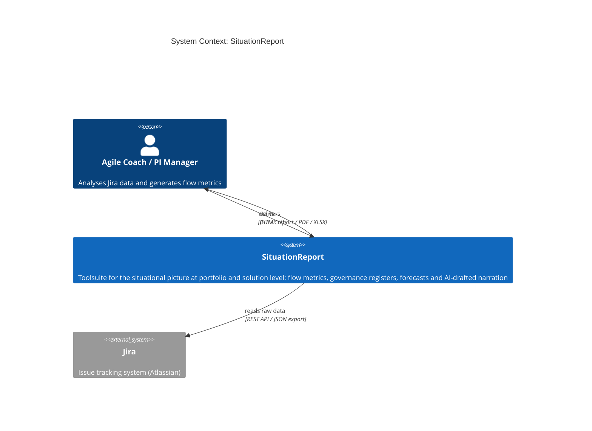
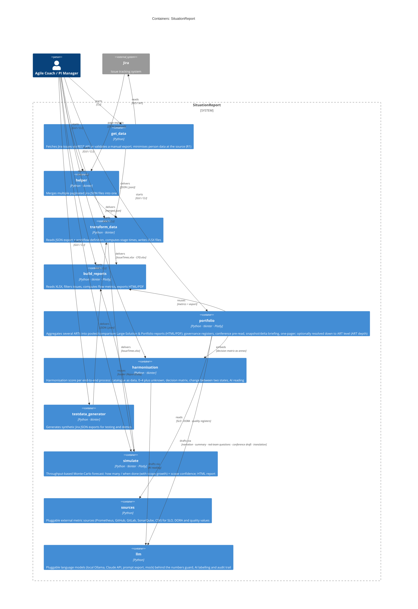
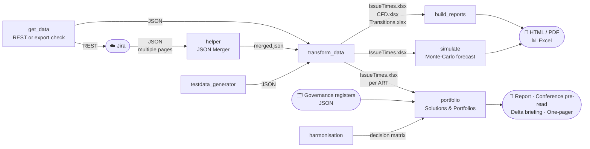
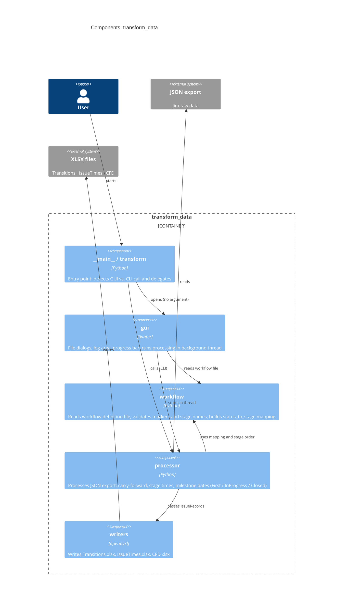
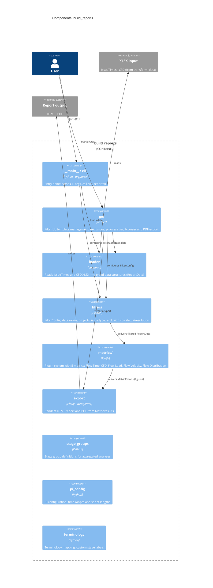
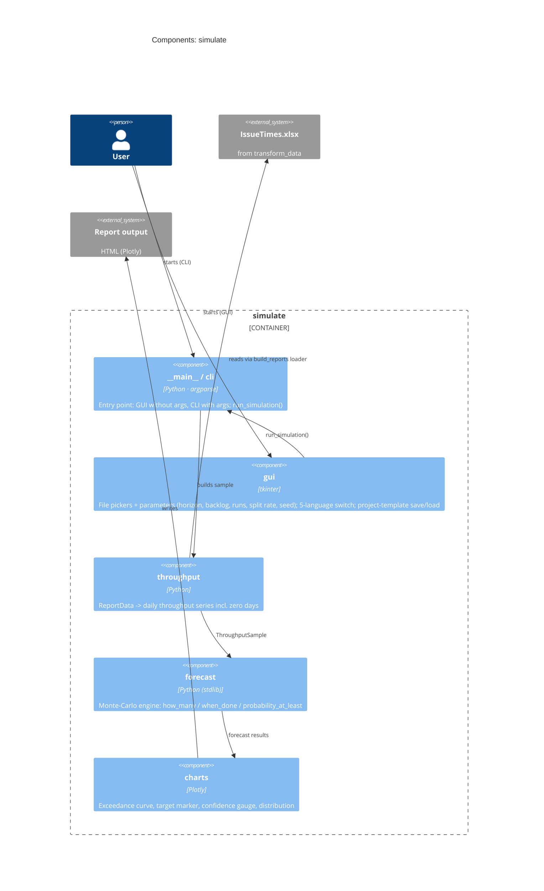
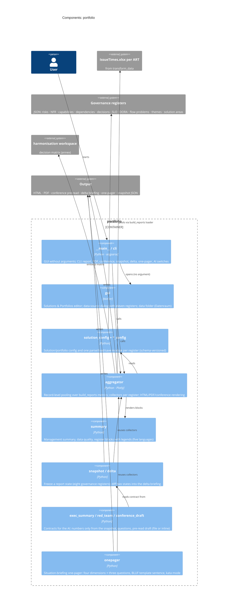

# Architecture

SituationReport follows the **C4 model** (Simon Brown): Context → Containers → Components.
The diagrams show three levels of detail — from the bird's-eye view down to individual files.

---

## Level 1 — System Context

Who uses the system and what external systems does it interact with?

---

## Level 2 — Containers (Modules)

What modules exist, what technologies do they use, and how does data flow?

### Data flow

---

## Level 3 — Components: transform_data

| File | Responsibility |
|------|---------------|
| `__main__.py` / `transform.py` | Entry point; detects GUI vs. CLI mode |
| `gui.py` | tkinter UI; background thread; progress bar after 3 s |
| `workflow.py` | Read, validate, and map workflow definition file |
| `processor.py` | Process Jira JSON; stage times, carry-forward, milestone fallbacks |
| `writers.py` | XLSX output (Transitions, IssueTimes, CFD) |

---

## Level 3 — Components: build_reports

| File / Directory | Responsibility |
|-----------------|---------------|
| `__main__.py` / `cli.py` | Entry point; argparse; `run_reports()` |
| `gui.py` | tkinter UI; templates; exclusions; progress bar; browser/PDF export |
| `loader.py` | Read XLSX → `ReportData` (typed dataclasses) |
| `filters.py` | `FilterConfig`; `apply_filters()`; exclusion logic |
| `metrics/base.py` | Abstract `MetricPlugin` class + `MetricResult` container |
| `metrics/*.py` | Concrete metrics: `flow_time`, `cfd`, `flow_load`, `flow_velocity`, `flow_distribution` |
| `export.py` | HTML rendering; PDF export via WeasyPrint |
| `stage_groups.py` | Stage group definitions |
| `pi_config.py` | PI time ranges, sprint lengths |
| `terminology.py` | Custom terminology |

---

## Level 3 — Components: simulate

| File | Responsibility |
|------|---------------|
| `__main__.py` / `cli.py` | Entry point; argparse; `run_simulation()` |
| `gui.py` | tkinter UI (5 languages via flag switch); parameters; project-template save/load (`project_template`, `MODULE_SIMULATE`); HTML report + browser |
| `throughput.py` | `ReportData` → daily throughput series (incl. zero days) |
| `forecast.py` | Monte-Carlo engine: `how_many`, `when_done` (scope growth), `probability_at_least` |
| `charts.py` | Plotly: exceedance curve, target marker, confidence gauge, when-done distribution |

Standard library only (`random`, `bisect`, `statistics`) — no numpy/pandas — for
maximum portability; reuses `build_reports.loader` to read the input.

---

## Level 3 — Components: portfolio

| File | Responsibility |
|------|---------------|
| `__main__.py` / `cli.py` | Entry point; argparse; `--pdf`, `--conference`, `--snapshot`, `--delta`, `--onepager`, `--kata`, AI switches |
| `gui.py` | Solutions & Portfolios GUI; data-source dialog (eleven register paths); templates; data folder |
| `solution_config.py` | Solution/portfolio config (members, mode, stage map, register paths, conference date) |
| `*_config.py` | One module per register: ROAM risks, NFR/runway, capabilities, dependencies, decisions, SLO, DORA, flow problems, themes, solution areas |
| `aggregator.py` | Record pooling; collectors; HTML report, PDF pages, conference pre-read (four inputs + annex) |
| `summary.py` | Management summary, data-quality flag, register tables and figures, legends |
| `decision_point.py` | Cross-value-stream pressure and the decision-point alarm (P4) |
| `snapshot.py` / `delta.py` | Report snapshot (eight governance registers) and delta briefing |
| `exec_summary.py` / `red_team.py` / `conference_draft.py` | AI contracts (D1, D5, D8) — numbers come from the snapshot, never from the model |
| `onepager.py` | One-pager (P6): deterministic reading of the same collectors; decision points only, no recommendations |
| `briefing.py` | Spoken briefing draft (M6): the one-pager's cells as citable facts `E/…` plus the fact index; guarded like D3/D4; own file, page stays AI-free |
| `report_texts.py` | All report texts in five languages |

---

## Level 3 — Components: harmonisation

| File | Responsibility |
|------|---------------|
| `__main__.py` / `cli.py` | GUI without arguments; CLI: report, `--since`/`--delta`, `--narrate` |
| `model.py` | Workspace (catalogue, processes, assessments, decisions) with schema validation |
| `score.py` | Score arithmetic: 0–4 plus "unknown", evidence grade → confidence, median and range |
| `delta.py` | Change between two states (`filter_as_of`, `compute_delta`) |
| `reading.py` | AI reading: contract without persons, prompt forbids recommendations, exit code 3 without a draft |
| `render.py` | Decision matrix, delta HTML, matrix block for the portfolio conference pre-read |
| `gui.py` | tkinter editor and report dialog (five languages) |

---

## Level 3 — Components: llm

| File | Responsibility |
|------|---------------|
| `base.py` | Provider protocol, `LlmResult`, deployment classes (local · remote · export · mock) |
| `providers/*.py` | Backends: `ollama` (local), `claude` (API), `export` (writes the prompt bundle instead of calling a model), `mock` |
| `narrate.py` | One entry point for every AI purpose: contract in, draft out, guards applied |
| `guard.py` | Numbers guard (no figure that is not in the contract) and the labelling banner (Art. 50) |
| `audit.py` | Operator record: one JSONL line per call (purpose, provider, model, address, hashes) |
| `prompts.py` | Versioned system prompts per purpose (exec summary, narration, red team, translation, conference draft, harmonisation reading) |
| `export.py` | Prompt bundle (`build_bundle`, `write_bundle`, clipboard) for a model run on another machine |
| `translate.py` | Report translation (D6) through the same guards |
