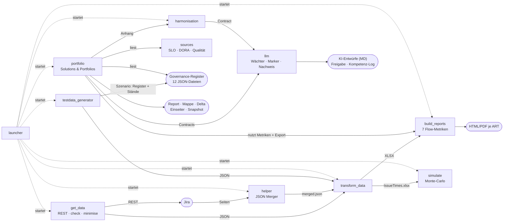
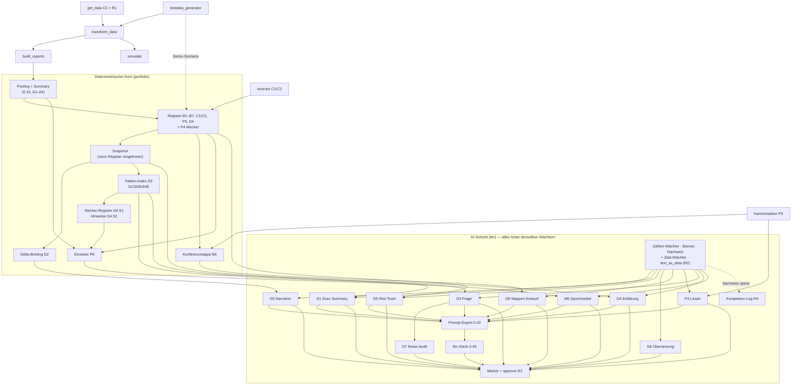

# Beta-Vorbereitung · Feature-Inventur (Stand 23.10.2026, v0.54.0)

Arbeitsdokument für die UX-Überarbeitung auf dem Branch `beta/ux-redesign`. Zweck: alle bisher
gebauten Features mit Kurzbeschreibung an einem Ort, dazu die Verbindungen zwischen ihnen — damit beim
Neuverdrahten der Oberfläche nichts verloren geht und am Ende jedes Feature einen Platz hat.
Quellen: README, CHANGELOG (v0.2.0 – v0.54.0), Roadmap, `docs/modules/*`, `docs/architecture.md`.

**Legende Oberfläche:** GUI = tkinter-Fenster · CLI = Kommandozeile · HTML/PDF/MD = erzeugte Dokumente ·
Datei = JSON/XLSX-Artefakt. **Kennung** = Roadmap-/Changelog-Bezeichner.

## 1. Zahlen zum Einstieg

| | |
|---|---|
| Module | 11 (`launcher`, `get_data`, `helper`, `transform_data`, `build_reports`, `portfolio`, `harmonisation`, `simulate`, `testdata_generator`, `sources`, `llm`) |
| tkinter-Fenster | 8 (`launcher`, `get_data`, `helper`, `transform_data`, `build_reports`, `portfolio`, `harmonisation`, `simulate`, `testdata_generator`) + 2 Dialoge in `llm` (`check`, `export` Zwischenablage) |
| Knöpfe je Fenster (Zählung `ttk.Button`) | portfolio 30 · build_reports 21 · testdata_generator 15 · harmonisation 9 · launcher 8 · transform_data 6 · get_data 5 · simulate 3 |
| Erzeugte Dokumentarten | HTML-Report, PDF-Report, Konferenzmappe, Delta-Briefing, Einseiter, Harmonisierungs-Matrix, Forecast-Report, Snapshot-JSON, 12 Markdown-Entwurfsdateien der KI-Schicht, XLSX (3), Export-JSON |
| Sprachen | GUI und Reports: DE · EN · RO · PT · FR (get_data, llm: DE/EN); KI-Entwürfe DE/EN (Banner 5 Sprachen) |
| Releases | 78 (v0.2.0 25.04.2026 → v0.54.0 22.10.2026) |

## 2. Features je Modul

### 2.1 `launcher` — der Einstieg
| Kennung | Feature | Kurz | Oberfläche |
|---|---|---|---|
| L1 (0.8.0) | Karten-Launcher | Alle Module als Karten mit Reifegrad-Badge (Alpha/Beta), Start per Klick; Start-Skripte `.bat/.sh/.command` | GUI |
| L2 (0.8.1) | Update-Prüfung | Hintergrund-Check auf neue Version, Banner | GUI |
| L3 (0.9.x) | Manuals je Sprache | Knopf „Manual öffnen" je Modul, fünf Sprachen; Get-Data-„How to"-Dialog | GUI |
| L4 (0.15.0) | Zweigeteilter Einstieg | „Large Solutions & Portfolios" links, ART-Werkzeuge rechts | GUI |

### 2.2 `get_data` — Daten holen (C3, R1)
| Kennung | Feature | Kurz | Oberfläche |
|---|---|---|---|
| C3 (0.21.0) | REST-Abruf | Jira v3/v2, Cloud/Bearer, Paginierung, Token nur aus ENV | GUI · CLI `fetch` |
| C3 (0.21.0) | Export-Prüfung | Manuellen Export validieren: Pflichtfelder, Changelog, Seiten, Duplikate | GUI · CLI `check` |
| R1 (0.51.0) | Datenminimierung | Allowlist der Pipeline-Felder, Changelog vollständig mit anonymisierten Personen; `minimise`, Warnung in `check` | GUI · CLI `minimise` |

### 2.3 `helper` — JSON Merger (0.9.0)
| Kennung | Feature | Kurz | Oberfläche |
|---|---|---|---|
| H1 | JSON Merger | Mehrere paginierte Jira-Exporte zu einer Datei, Duplikate raus | GUI · CLI |

### 2.4 `transform_data` — Rohdaten → Stage-Zeiten
| Kennung | Feature | Kurz | Oberfläche |
|---|---|---|---|
| T1 | Transformation | JSON + Workflow-Datei → IssueTimes.xlsx, CFD.xlsx, Transitions.xlsx; Formel-Injection-Härtung | GUI · CLI |
| T2 (0.14.0) | Übergabe | „Weiter zu Build Reports" mit den erzeugten Dateien | GUI |
| T3 (0.11.0) | Projekt-Template | Gemeinsames Template-Format aller GUIs (Schema v5), Speichern/Laden | GUI |

### 2.5 `build_reports` — Flow-Metriken je ART
| Kennung | Feature | Kurz | Oberfläche |
|---|---|---|---|
| B-M1 | Flow Time / Cycle Time | Verteilung, Perzentile, Ziel-Zykluszeit, Methode A/B | HTML · PDF |
| B-M2 | Flow Velocity / Throughput | fertige Vorgänge je Periode | HTML · PDF |
| B-M3 | Flow Load / WIP | WIP je Stage und Alter, Boxplot | HTML · PDF |
| B-M4 | CFD | Kumulierter Fluss, Trendlinien | HTML · PDF |
| B-M5 | Flow Distribution | Typen, Stage-Dominanz, mittlere Zykluszeit | HTML · PDF |
| B-M6/M7 (0.5–0.7) | Process Flow: Transitions / Time | Gerichteter Graph der Statuswechsel, Kantenbreite nach Verweildauer | HTML · PDF |
| A6 (0.29.0) | Flow Debt | Bestand, Durchsatz, Durchlaufzeit nebeneinander | HTML |
| AA1 (0.30.0) | Zykluszeit-Grenzen | Grenzen im Diagrammkopf | HTML |
| (0.32/0.33) | Reportsprache | Reports und Diagrammbeschriftungen folgen der GUI-Sprache; Terminologie SAFe/Global | GUI · HTML |
| (0.4.0) | Filter, Templates, Sprachen | Issue-Filter, Nullzeit-Schwelle, Template-Menü, Flaggen-Sprachwahl | GUI |

### 2.6 `portfolio` — Solutions & Portfolios (Phasen A–D, P1–P6)
| Kennung | Feature | Kurz | Oberfläche |
|---|---|---|---|
| (0.15.0) | Solutions und Portfolios | Mitglieder-ARTs poolen (pooled) oder vergleichen (comparison), Portfolio aus Solution-Templates; Management-Summary; HTML/PDF | GUI · CLI · HTML · PDF |
| (0.25.0) | Datenraum | Relative Pfade, Datenquellen-Dialog mit zwölf Registerfeldern, generierte Register-Testdaten | GUI |
| (0.28.0) | ART-Tiefe | Auswertung bis auf ART-Ebene | GUI · HTML |
| A1–A4 (0.18.0) | Qualitäts-Flag, Summary-Spalten, Ausreißer, Stage-Map | Konfidenz je Quelle, Ausreißer-Markierung, kanonische Stage-Map | HTML |
| B1 (0.19) | Capability-Map & Health | Register `capabilities.json`, Health je Capability | HTML · PDF |
| B2 (0.19) | NFR / Architecture Runway | Register, Status, Runway-Lücken | HTML · PDF |
| B3 (0.19) | ROAM-Risk-Board | Register, ROAM-Status, Mitigation | HTML · PDF |
| B4 (0.19) | Decision/Assumption-Log | Entscheidungen und Annahmen mit Prüfdatum | HTML · PDF |
| B5 (0.18–0.20) | Dependency-Heatmap | Abhängigkeiten zwischen ARTs, Druck | HTML · PDF |
| P4 (0.29.0) | Entscheidungspunkt-Wecker | Cross-VS-Druck gegen vereinbarte Schwelle | HTML · PDF |
| B6 (0.20/0.22) | Flussproblem-Backlog & Konferenzmappe | Register, Überleben über Konferenzen, Pre-Read mit vier Inputs + Anhang | GUI · CLI · HTML |
| B7 (0.20) | Strategic Themes & Roadmap | Themes ↔ Epics, verwaiste Themes, Zombie-Epics | HTML · PDF |
| C1/C2 (0.21.0) | SLO- & DORA-Register | Werte aus `sources`, SLO-Status, DORA-Stufen | HTML · PDF |
| P5 (0.44.0) | Solution-Area-Register | Nähte, Rekurrenz-Signal ≥ 3 | HTML · PDF |
| D4 (0.48/0.49) | Wecker-Register + Hinweise | `decision_points.json` mit vier Zuständen; Auffälligkeits-Hinweise aus Snapshot-Reihe (Median/MAD); KI-Erklärung je ausgelöstem Wecker | GUI · CLI `--alarms --history` · HTML · MD |
| D2 Kern (0.19–0.23) | Snapshot & Delta-Briefing | Stand einfrieren (neun Governance-Register), zwei Stände vergleichen | GUI · CLI `--snapshot --delta` · HTML · MD |
| P6 (0.43.0) | Lagevortrag-Einseiter | 4 Dimensionen × 3 Fragen, BLUF, Konfidenz je Zelle, Kata-Modus | GUI · CLI `--onepager` · HTML |
| D1 (0.26.0) | KI-Executive-Summary | Entwurf unter der Management-Summary, Contract aus dem Snapshot | GUI · CLI `--narrate` · HTML · MD |
| D2 KI (0.23.0) | KI-Narration des Deltas | Entwurf zum Delta-Briefing | GUI · CLI · MD |
| D5 (0.26.0) | Red-Team-Fragen | Premortem-Fragen aus dem Decision-Log, Fragen-Wächter | GUI · CLI `--red-team` · MD |
| D6 (0.26.0) | Übersetzung | Entwürfe in fünf Sprachen | GUI · CLI `--translate` · MD |
| D8 (0.37.0) | KI-Entwurf Konferenzmappe | Einleitung + je Input ein Absatz, Datei oder inline | GUI · CLI `--conference-draft` · HTML · MD |
| D3 (0.46.0) | Befragbares Lagebild | Fakten-Index mit Pfaden, Frage mit Zitierpflicht, Hygiene (eigene Einschätzung zuerst) | GUI-Dialog · CLI `--ask` · MD |
| D7 (0.47.0) | Noise-Audit | Dieselbe Frage n-fach, Konsistenz der Zitate und Zahlen | GUI · CLI `--noise` · MD |
| M6 (0.50.0) | Lagevortrag-Entwurf | Sprechzettel zum Einseiter, Zellen als zitierbare Fakten | GUI · CLI · MD |
| P3-Anhang (0.36.0) | Harmonisierung in der Mappe | Entscheider-Matrix als Anhang der Konferenzmappe | HTML |

### 2.7 `harmonisation` — Harmonisierungs-Score (P3, 0.35/0.36)
| Kennung | Feature | Kurz | Oberfläche |
|---|---|---|---|
| P3 | Assessment | Fragenkatalog als Daten, Antworten 0–4 oder unbekannt mit Beleggrad, Score je Dimension mit Konfidenz | GUI · CLI |
| P3 | Entscheider-Matrix | Je End-to-End-Prozess: Scores, Spanne, Board-Entscheidung | HTML |
| P3 Schritt 2 | Delta zweier Stände | Score-Veränderung ohne Wertung | HTML · MD |
| P3 Schritt 2 | KI-Lesart | Entwurf mit Wächtern, Zweck `p3_reading` | MD · HTML |

### 2.8 `simulate` — Monte-Carlo-Prognose (0.17.x)
| Kennung | Feature | Kurz | Oberfläche |
|---|---|---|---|
| S1 | Wie viele bis wann | Kapazitätsprognose, Horizont oder Zieldatum | GUI · CLI · HTML |
| S2 | Wann fertig | N Vorgänge, optional Scope-Wachstum | GUI · CLI · HTML |
| S3 | Konfidenz-Anzeige | Wahrscheinlichkeit, Scope bis Datum X zu schaffen | HTML |

### 2.9 `testdata_generator` — synthetische Daten (0.8.5 → 0.41.0)
| Kennung | Feature | Kurz | Oberfläche |
|---|---|---|---|
| TG1 | Generator | Jira-JSON mit Workflow, Zykluszeit-Verteilung, PI-Länge, vier Anti-Pattern-Formen | GUI · CLI |
| TG2 (0.12.0) | Direktreport | „Report erstellen" aus dem Generator | GUI |
| TG3 (0.25/0.26) | Portfolio-Szenario | Demo-Portfolio mit Registern, Vor- und Jetzt-Stand, ART-Profile | CLI `--scenario` |
| TG4 (0.38–0.41) | Realismus, Fortschreibung, Lernen | Realistische Statuswege, zweiter Abzug, Snapshot-Rotation, Lernen aus echten Transitionen | CLI · GUI |

### 2.10 `sources` — Kennzahlen-Quellen (C1/C2, 0.21.0)
| Kennung | Feature | Kurz | Oberfläche |
|---|---|---|---|
| C1/C2 | Provider | Prometheus, GitHub DORA, GitLab DORA, SonarQube, CSV; ein Reader je System | CLI |

### 2.11 `llm` — KI-Schicht (D-Phase, Prompt-Export, R2–R4)
| Kennung | Feature | Kurz | Oberfläche |
|---|---|---|---|
| D2 (0.23.0) | Provider | Ollama lokal, Claude API, Mock, seit 0.42.0 `export` | GUI-Auswahl · CLI |
| D9 (0.34.0) | Kennzeichnung nach Adresse | Deployment-Klasse folgt der Adresse, Nachweis als Hash | Banner · Nachweis |
| — | Drei Wächter | Zahlen-Wächter, Banner (Art. 50), Betreiber-Nachweis `llm_audit.jsonl` | alle Entwürfe |
| D3 (0.46) | Zitat-Wächter | Jede Aussage mit Pfad, Zahlen aus zitierten Fakten | D3/D4/M6 |
| (0.42.0) | Prompt-Export | Bündel statt Modellaufruf, Zwischenablage | GUI · CLI |
| (0.45.0) | `llm check` | Rückweg: externe Antwort gegen das Bündel prüfen | GUI-Knopf · CLI |
| R2 (0.52.0) | Leitplanke (e) | `text_as_data`, Daten-Regel in jedem Prompt, Geruchs-Wächter | alle Contracts |
| R3 (0.53.0) | KI-Marker + `approve` | Marker `sr-ai-draft/1`, Freigabe mit Team und Nachweis | MD · HTML · CLI |
| R4 (0.54.0) | KI-Kompetenz-Log | `ai_literacy.json`, Bericht je Team, Bedarfsbild | CLI |
| D6 | `llm translate` | Übersetzung einer Datei | CLI |

### 2.12 Querschnitt
| Kennung | Feature | Kurz |
|---|---|---|
| (0.4.0 ff.) | Fünf Sprachen | GUI, Reports, Manuals, Onepager |
| (0.9.3 ff.) | Manuals | Je Modul PDF in fünf Sprachen, aus Generatoren |
| (0.11.0) | Projekt-Template | Ein Format für alle GUIs |
| (0.27.0, 0.46.0) | Tutorials | KI-Funktionen in der Praxis; Das Lagebild befragen (DE/EN, PDF) |
| (0.17.0 ff.) | Qualitäts-Gate | ruff, mypy, bandit, pip-audit, Coverage, Release-Zip, Deploy Docs |
| R5 (Doku) | Rechtsrahmen | Leitplanken (a)–(e), Rechtsstand 10/2026 |

## 3. Wie die Module zusammenhängen (Datenfluss)

## 4. Wie die Features aufeinander aufbauen (Abhängigkeiten)

**Lesehilfe.** Alles Zahlenhafte entsteht links im Kern; die KI-Schicht formuliert nur, und jeder
KI-Zweck läuft durch dieselben Wächter. Drei Bausteine tragen viele andere: der **Snapshot** (D1, Delta,
Fakten-Index), der **Fakten-Index** (D3, D4, M6, Noise) und die **Wächter** (jeder Entwurf, Export,
Rückweg, Freigabe). Wer die Oberfläche neu verdrahtet, muss diese drei Knoten sichtbar halten.

## 5. Oberflächen, die die UX-Überarbeitung betrifft

| Oberfläche | Heute | Beobachtung für die Beta |
|---|---|---|
| Launcher | 8 Karten, Badges, Manual-Knöpfe | Einstieg ohne Empfehlung „wo anfangen"; zwei Hälften (Portfolio / ART) |
| Portfolio-GUI | 30 Knöpfe, 12 Registerfelder im Datenquellen-Dialog, KI-Leiste (Haken, Provider, Modell, Adresse) | Die meisten Funktionen der Suite hängen an einem Fenster; Reihenfolge der Knöpfe folgt der Baureihenfolge, nicht dem Ritual |
| Build-Reports-GUI | 21 Knöpfe, Filter, Templates, Metrik-Auswahl | Scrollbares Formular (FullHD-Fix 0.8.3) |
| Testdaten-Generator | 15 Knöpfe, viele Parameter | Zielgruppe Entwickler/Demo, nicht Stab |
| transform_data, get_data, helper, simulate, harmonisation | 3–9 Knöpfe | Einzelzweck-Fenster, Übergaben per Datei |
| HTML-Reports | Report, Mappe, Delta, Einseiter, Matrix, Forecast | Druck aus dem Browser, Farblegende, Sprache der GUI |
| Markdown-Entwürfe | 12 Dateiarten neben den Reports | Für Redaktion und Freigabe (`llm approve`) |
| Manuals + Tutorials | 10 Manual-PDFs × 5 Sprachen, 2 Tutorials | Testnutzer brauchen Tutorials statt Manual-Absätze (Lehre D3) |

Offene Punkte aus der Gedankenliste, die in die UX-Arbeit gehören: GUI-Feld „Snapshot-Ordner" für die
Reihe, Hinweise im Report-Block bei vereinbartem Snapshot-Ordner, Tutorials für Noise-Audit und
`llm check`, Knopf für `llm check` in der Harmonisation-GUI.
