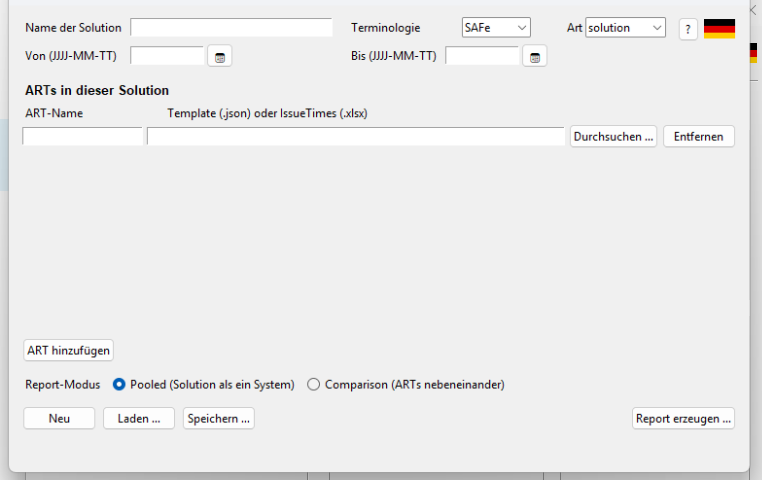

# portfolio

Aggregates several already-configured ARTs into a combined **Large-Solution** or
**Portfolio** report — as **pooled** (the solution seen as one system) or
**comparison** (units side by side). It reuses the `build_reports` metrics; the
individual ART reports are only referenced, not changed.

**Status:** available (Alpha)

## Manuals

| Language | Download |
|----------|----------|
| Deutsch (DE) | [Benutzerhandbuch](../portfolio_Benutzerhandbuch.pdf) |
| English (EN) | [User Manual](../portfolio_UserManual.pdf) |
| Română (RO) | [Manual de Utilizator](../portfolio_ManualUtilizator.pdf) |
| Português (PT) | [Manual do Utilizador](../portfolio_ManualUtilizador.pdf) |
| Français (FR) | [Manuel d'utilisation](../portfolio_ManuelUtilisateur.pdf) |

---

## Key concepts

| Term | Meaning |
|------|---------|
| ART | Agile Release Train / team group — the level you already report on in `build_reports`. |
| Solution | A grouping of several ARTs (references their project templates). |
| Portfolio | A grouping of several Solutions (Portfolio > Solutions > ARTs). |
| Pooled | Mode: all issues are merged into **one** dataset — the solution as a single system. |
| Comparison | Mode: each unit (ART or Solution) is shown separately, side by side. |

## Interface



## Start

### GUI

```bash
python -m portfolio
```

Or click the **Solutions & Portfolios** card on the left of the SituationReport
launcher.

### Command line

```bash
python -m portfolio solution.json --mode pooled --output report.html
# comparison mode / PDF output:
python -m portfolio solution.json --mode comparison --pdf report.pdf
```

The configuration file (`solution.json`) lists the members (ARTs for a solution,
Solutions for a portfolio) and is created/edited in the GUI.

## Report contents

Every report starts with the **management summary** — one row per unit (pooled:
the whole solution/portfolio): items, completed, open (WIP), cycle-time
percentiles (median/85th/95th), the target-CT share, and the **end-to-end lead
time** (Created → Closed, median/85th; in pooled mode the solution lead time
across all ARTs).

Below it, the **Data Quality per Source** table shows for every source: record
count, its **share** of all items, the share without a First Date, the open
share, whether CFD data was supplied, the data freshness — and a traffic-light
**confidence** (high/medium/low, thresholds documented in `summary.py`). The
title carries the coverage ratio ("x/y sources delivered data"). In the PDF the
table is page 2.

In **comparison** mode, Median-CT and 95th-percentile cells are highlighted
red when they exceed 1.5× the column median (three rows minimum) — the
"which unit is the outlier?" question answers itself.

## Capability map & health (optional)

A solution config may reference a capability map via
`"capabilities": "path/to/capabilities.json"`; the report then renders a
**Capability Map & Health** table below the quality table (PDF: own page). A
portfolio aggregates the maps of all member solutions and adds a **Solution**
column. The map:

```json
{
  "capabilities": [
    {
      "id": "C-1",
      "title": "Data insights & reporting",
      "health": "critical",
      "arts": ["ART Beta-3"],
      "owner": "ART Beta-3",
      "assessed_on": "2026-08-26",
      "notes": "optional"
    }
  ]
}
```

`health` is one of `healthy` / `at_risk` / `critical` — **assessed by people**
in PI planning/review (`assessed_on` records when). `arts` names the member
ARTs contributing to the capability; a capability with no contributing ARTs is
flagged as **uncovered** (business value nobody delivers), and an ART name
that is not among the solution's members is logged as a drift warning.
Critical capabilities sort first with coloured health cells; the title counts
critical/at-risk/uncovered. `owner` names a team, not a person. The capability
map (business capabilities) is deliberately **not** the `stage_map` (workflow
stages) — different dimension, different source. Missing or invalid files are
logged and skipped.

## ROAM risk board (optional)

A solution config may reference a risk register via `"risks": "path/to/risks.json"`;
the report then renders a **ROAM board** below the quality table and the
capability map (PDF: its own page). A portfolio aggregates the registers of all member solutions and adds a
**Solution** column. The register:

```json
{
  "risks": [
    {
      "id": "R-1",
      "title": "Test environment not ordered yet",
      "roam": "owned",
      "owner": "System Team",
      "impact": "high",
      "status_since": "2026-07-15",
      "notes": "optional"
    }
  ]
}
```

`roam` is one of `resolved` / `owned` / `accepted` / `mitigated`, `impact` one
of `high` / `medium` / `low`. Rows are grouped in R-O-A-M order with coloured
category and impact cells. `status_since` (when the risk entered its current
category) drives **aging**: an *owned* risk older than 30 days gets a red
"Since" cell — ownership without movement is exactly what the board surfaces.
The title counts total, owned, and aging risks. `owner` names a **team, not a
person**. A missing or invalid risks file is logged and skipped — governance
data never breaks the flow report.

## NFR / architecture-runway dashboard (optional)

A solution config may reference an NFR register via `"nfr": "path/to/nfr.json"`;
the report then renders an **NFR & Architecture Runway** dashboard below the
ROAM board (PDF: own page, both tables stacked). A portfolio aggregates the
registers of all member solutions and adds a **Solution** column. The register:

```json
{
  "nfrs": [
    {
      "id": "N-1",
      "title": "API response time",
      "target": "p95 < 200 ms",
      "actual": "p95 = 340 ms",
      "status": "violated",
      "owner": "ART Beta-1"
    }
  ],
  "runway": [
    {
      "id": "RW-1",
      "title": "Automated failover",
      "status": "gap",
      "needed_by": "2026-08-13",
      "owner": "ART Beta-2"
    }
  ]
}
```

NFR `status` is one of `met` / `at_risk` / `violated`, runway `status` one of
`in_place` / `building` / `gap` — **assessed by people** in PI planning/review;
the tool deliberately does not compute target vs. actual ("the LLM writes, it
does not calculate" applies to the tool as well). Violated NFRs and runway gaps
sort first with coloured status cells; a runway element whose `needed_by` has
passed while it is not in place renders as **overdue** (red date cell). The
title counts NFRs (violated/at risk) and runway elements (gaps/overdue).
`owner` names a team, not a person. Missing or invalid files are logged and
skipped.

## Dependency / integration heatmap (optional)

A solution config may reference a dependency register via
`"dependencies": "path/to/dependencies.json"`; the report then renders a
**Dependency & Integration Heatmap** below the NFR dashboard (PDF: own page).
A portfolio aggregates the registers of all member solutions and adds a
**Solution** column to the detail table. The register:

```json
{
  "dependencies": [
    {
      "id": "D-1",
      "title": "Billing API contract",
      "from": "ART Alpha-1",
      "to": "ART Alpha-3",
      "status": "blocked",
      "due": "2026-08-18",
      "notes": "optional"
    }
  ]
}
```

`from` needs something that `to` delivers; `status` is one of `blocked` /
`at_risk` / `on_track` / `done`. The **heatmap** counts open dependencies
(status ≠ done) per from/to pair — each cell carries the colour of its most
urgent status. Below it, the detail table lists every dependency (blocked
first); a dependency whose `due` has passed while not done renders as
**overdue** (red date cell). The title counts blocked/at-risk/overdue. `to`
is deliberately **not** validated against the member list — integration
points may target another solution's ART, a vendor, or an external system
(cross-solution dependencies become visible in the portfolio report). Missing
or invalid files are logged and skipped.

## Decision / assumption log (optional)

A solution config may reference a decision log via
`"decisions": "path/to/decisions.json"`; the report then renders a
**Decision & Assumption Log** table below the dependency heatmap (PDF: own
page). A portfolio aggregates the logs of all member solutions and adds a
**Solution** column. The log — lightweight, ADR-style:

```json
{
  "entries": [
    {
      "id": "ADR-1",
      "kind": "decision",
      "title": "Buy vendor sync service instead of building",
      "status": "accepted",
      "owner": "ART Beta-1",
      "logged_on": "2026-04-05",
      "supersedes": "ADR-0",
      "notes": "optional"
    },
    {
      "id": "AS-1",
      "kind": "assumption",
      "title": "Data quality improves with the next rollout",
      "status": "open",
      "review_by": "2026-08-23"
    }
  ]
}
```

`kind` is `decision` (status `proposed` / `accepted` / `superseded`) or
`assumption` (status `open` / `confirmed` / `invalidated`) — the parser
enforces the matching status set. `supersedes` must name an entry in the same
log, keeping the trade-off trail intact. `review_by` gives an assumption its
expiry: an **open assumption whose review date has passed** sorts first and
gets a red "review due" cell — the hook for red-team/premortem sessions.
`owner` names a team, not a person. Missing or invalid files are logged and
skipped.

## Delta briefing (D2, deterministic core)

Two commands turn report states into a "what changed?" briefing:

```bash
python -m portfolio portfolio.json --snapshot state_now.json
python -m portfolio --delta state_prev.json state_now.json --output delta.html
```

`--snapshot` freezes the computed report state (metrics per unit and pooled,
source quality incl. confidence, all seven governance registers — flow
problems with their conference counter and SLOs since 0.37.1) into a small
schema-v1 JSON; `--as-of YYYY-MM-DD` pins the observation date (default:
today). Without `--output`/`--pdf`, only the snapshot is written.

`--delta PREV NOW` needs no config: it compares two snapshots and emits the
briefing — metric deltas at display precision (invisible float changes are
dropped), throughput in the period, confidence transitions per source, and
per governance register the added/removed entries, status transitions
(worsenings first, red; improvements green) and **newly overdue** items
(judged against each snapshot's as-of date, so only genuine flips count).
`--output *.md` writes Markdown, any other suffix the self-contained HTML
page, no `--output` prints Markdown to stdout. A delta with no changes says
so explicitly — silence is information.

The Markdown output is deliberately the input contract for the optional LLM
narration layer (D2 part 2, not yet built): the LLM may rephrase it, never
add numbers — the numbers are made here, deterministically.

**In the GUI:** the manager window carries two matching buttons — **Save
snapshot …** freezes the currently configured solution/portfolio to a JSON
file (suggested name includes today's date), and **Delta briefing …** asks
for the earlier and the later snapshot and opens the briefing in the
browser. The demo path is even shorter: the test-data generator's
demo-portfolio section gains **Open Delta Briefing**, which renders the
scenario's shipped `snapshot_prev/now.json` pair directly.

## Flow-problem backlog & conference pre-read (optional, B6)

`"flow_problems": "flow_problems.json"` renders the **Flow-Problem
Backlog** — the Value-Stream Conference's most important input. Each
problem carries id, title, status (`open`/`committed`/`resolved`/
`dropped`), the affected `value_streams` (cross-VS is *derived*: more
than one stream), who raised it, the owning team, `raised_on`, a
`conferences` counter (in how many conferences it has been on the
table — maintained by people), `resolution_commitment` and
`follow_up_pi`. The workshop pattern "logged, never mitigated, back next
PI" becomes measurable: an unresolved problem seen in **≥ 3 conferences**
sorts first with a red counter.

The **conference pre-read** bundles the meeting inputs into one light,
printable page:

```bash
python -m portfolio portfolio.json --conference preread.html --conference-date 2026-09-10
```

Input 1 · current data (summary + source quality), Input 2 · impediment
backlog & governance (flow problems first, then ROAM and dependencies),
Input 3 · business objectives (capability map + SLOs), Input 4 · the
integrated roadmap & strategic themes (B7). Since 0.36.0 a solution that
names a harmonisation workspace **folder** in `"harmonisation"` adds the
decision matrix of the `harmonisation` module as an **annex after
input 4** — a board view, deliberately not a fifth conference input.
The full interactive report stays the detail source.

**AI drafts for the pre-read (D8, since 0.37.0).** `--conference` together
with `--narrate [PROVIDER]` drafts five labeled parts — an introduction over
all four inputs and one paragraph per input — into the editing file
`<FILE>.narration.md`; the pre-read itself stays deterministic. With
`--conference-draft inline` the drafts are also placed into the page
(introduction before input 1, each paragraph under its heading). Every part
has its own deterministic contract built from the same registers the
pre-read shows, naming units, teams and registers but never persons; the
numbers guard, the Art. 50 banner and the operator evidence (purpose
`d8_conference`) apply unchanged. A part whose draft fails is named in the
file and left out; the pre-read is written regardless. In the GUI the AI
checkbox now applies to *Conference pre-read …* as well; the new box
*Pre-read draft: file only | in the pre-read* chooses the placement. **In the GUI:** the manager window's
*Conference pre-read …* button writes the same page for the currently
configured solution and opens it in the browser — print to PDF from
there; the test-data generator's demo section has *Open Conference
Pre-Read* for the one-click demo.

**The conference date (since 0.31.0).** The pre-read is written for a
*planned* date, not for the day it was produced. The **"Conference on"**
field in the manager window stores it as `report.conference_date` in the
configuration; `--conference-date` overrides it for a single run. The
header then names the date together with the remaining lead time ("noch
19 Tage"), and the file name suggests the conference date. **Without** a
date the header says *"Konferenztermin nicht gesetzt"* rather than
today's date, which would claim a conference held today. The field is
optional; configurations without the key load unchanged.

**Report language (since 0.32.0).** Report labels and texts follow the
**language of the window** — set the interface to French and the report comes
out in French. To pin a report to one language, pick it in the **Report
language** field; the default "—" means "follow the interface" and stores
nothing. Precedence: `--lang` (command line) beats `report.language`
(configuration) beats the window language; without any of the three, English.
**The date format follows** (de/ro `19.09.2026`, pt/fr `19/09/2026`, en
`2026-09-19`) — up to 0.31.0 every report carried the German format, including
the English one. **Since 0.33.0 the labels *inside* the charts follow
too** — axes, chart titles, curve names and the month abbreviations on the
time axes. **Not translated:** the metric names (still governed by the
SAFe/Global switch), everything that comes **from the data** — stage names,
issue types, project keys — and the Markdown form of the delta briefing (it is
the input contract of the AI narration, whose language `--llm-lang` governs).

**Colour legend (since 0.31.0).** Every shaded cell draws from the same
five backgrounds. Each page therefore opens with a **colour key** (green
· blue · yellow · red · grey), and every shaded table carries a line with
**its own status words** underneath — needed because the same colour
means different things per register: grey is *done* for a dependency and
*accepted* for a ROAM risk. Status scales are shown in full; single
flags (overdue, aging, uncovered) appear only when they occur on the
page. The same holds for the full report and the delta briefing.

## Situation-briefing one-pager (P6, since 0.43.0)

"One focused slide everyone can read at once." `--onepager page.html` renders the whole
situation on one A4 page: **four dimensions** (flow, quality, value, dependencies) ×
**three questions** (where do we stand, what has changed, what follows), **BLUF** on top,
a **confidence badge per cell**. Everything is deterministic and comes from the registers the
report already knows; no new arithmetic, no judgement.

```bash
python -m portfolio portfolio.json --onepager page.html --since-snapshot snapshots/snapshot_prev.json
python -m portfolio portfolio.json --onepager kata.html --kata
```

- **Column 1** — pooled metrics and flow problems; DORA tiers, SLO and NFR status; capability
  health, themes and epics; cross-VS pressure, dependencies and ROAM risks.
- **Column 2** — only with `--since-snapshot`: throughput, cycle-time shift and register
  transitions from the delta briefing. Without an earlier state the column says so.
- **Column 3** — **decision points only**, never a recommendation: flow problems past the third
  conference, breached SLOs, violated NFRs, overdue runway gaps, critical capabilities, themes
  without epic, epics without theme, assumptions past review date, the wake-up call above its
  threshold, overdue dependencies — plus an empty line for the presenter's own judgement.
- **BLUF** — a template sentence from the data: the largest deviation first (threshold breached,
  survivors, violations), otherwise "situation within the agreed thresholds".
- **Confidence** — flow follows the source quality (A1); registers count as high when dated
  within 30 days, medium when present but undated or older, missing when not connected.
- **Kata** (`--kata`, GUI box *Kata*) — the same page with empty cells and the questions as
  prompts: the practice sheet of the curriculum ("a situation analysis in 30 minutes"); the
  filled page is the answer key.

GUI: button **One-pager …** in the manager window; column 2 uses the snapshot last written in
this session.

### Spoken briefing draft — the AI reading of the one-pager (M6, since 0.50.0)

`--onepager page.html --narrate PROVIDER` additionally writes a **speaker's note**
`page.html.briefing.md` (German: `.vortrag.md`): the AI-drafted spoken briefing of about 90 seconds,
8 to 12 sentences in a fixed order — BLUF first, then the four dimensions (where do we stand, what
has changed), then the decisions needed *named only*, finally data confidence (cells rated low or
missing). The model's contract is the **one-pager itself as citable facts** (`E/bluf`, `E/meta`,
`E/flow.q1` … `E/dependencies.q3`, `E/<dimension>.decide`) plus the fact index of the stand
(`S1/S0/D`). The same guards as D3/D4 apply through `llm.narrate`: numbers guard, citation guard per
statement, banner, operator evidence with purpose `m6_briefing`; provider free, `export` included. A
discarded draft stops nothing — the one-pager stands, the file names the reason.

The one-pager page itself stays **byte-identical and AI-free**; its footer remains true. Guardrail of
pattern M6, written as the first line of the file: *draft, not the briefing* — the presenter checks,
cuts, delivers and signs responsible. Not included on purpose: no translation of the note, no noise
audit over drafts, no recommendation or option in the draft.

```bash
python -m portfolio portfolio.json --onepager page.html --since-snapshot snapshots/snapshot_prev.json --narrate ollama
python -m portfolio portfolio.json --onepager page.html --narrate export      # prompt bundle, back via llm check
```

GUI: the box **AI narration (draft)** also applies to the **One-pager …** button (never to the kata).

## Asking the situational picture (D3, since 0.46.0)

Step-by-step introduction with screenshots, real outputs and troubleshooting:
[tutorial "Asking the situational picture"](../tutorials/ask-the-picture.md)
(PDF: [DE](../ask_Tutorial_DE.pdf) / [EN](../ask_Tutorial_EN.pdf)).

`--ask "question"` asks **one question about one stand**. The stand (live from the config, or a
saved snapshot via `--ask-snapshot`) is flattened into a **fact index**: every number and every
register entry gets a path such as `S1/total.median_ct`, `S1/units(ART Alpha-2).open` or
`S1/governance.dependencies(D-7).status`; with `--since-snapshot` the earlier stand (`S0/…`) and
the changes (`D/…`) join, a connected harmonisation workspace adds `H/…`. The index is the model's
only context — no vector store, no retrieval, no external sources — and the **citation guard**
discards any answer in which a statement lacks a path citation, cites a path that does not exist,
or carries a number the cited facts do not contain. "The situational picture holds no information
on that." is the one permitted uncited sentence. Owner and other person fields never enter the
index (enforced by test); free text from registers is marked as data and shortened.

Decision hygiene (principle 7): `--own-view "…"` records your own assessment **before** the
answer; it is shown next to the answer in `<config>_<date>.ask.md` and never sent to the model.
The GUI button **Ask the picture …** opens a dialog with the question, the own-assessment field
(on by default, a preference of this machine) and the answer. Provider as everywhere (`--narrate`;
`export` writes the prompt bundle, and `llm check` then verifies the citations too); audit
purpose `d3_question`; exit code 3 when the answer is discarded. The answer explains, it never
recommends.

## Noise audit — how loud is the model? (D7, since 0.47.0)

`--ask "question" --noise 5` asks the same question five times in varied phrasings (run 1 is the
unchanged question, then your own variants from `--noise-variants`, then fixed frames such as
"In short: …") against the **same stand**. Because every D3 answer must cite its paths, the spread
is measured deterministically, with no second model judging similarity: **citation consistency**
(mean pairwise Jaccard similarity of the cited path sets, 0–100), the **core** (paths the majority
cites), the **scatter** (paths only one answer cites, with the statements marked), **number
conflicts** per path, and the rates of "no information" and rejected answers. A rejected answer is
not retried — it counts as spread. `--views FILE` lists staff assessments (one per paragraph) next
to the AI core, without any scoring. The protocol goes to `<config>_<date>.noise.md`; the GUI dialog
**Ask the picture …** has a **Repeats** field (> 1 runs the audit). The spread is a finding about the
model and the question, not a judgement about the situation.

## Decision points — the alarm register (D4, since 0.48.0)

`"decision_points": "decision_points.json"` renders the **alarm register** (pattern M4: early
indicator + threshold + agreed reaction). Each point names a **metric as a fact path** of the
question index (`S1/units(ART Alpha-3).p85_ct`, `D/total.open` with `"unit": "%"` for the relative
change to the previous stand, `S1/governance.dependencies.count(blocked)`, `S1/pressure.cross_vs` for
the P4 pressure), a comparison (`>=`, `<=`, `>`, `<`), the agreed `threshold`, the `question` the
alarm puts on the agenda, the agreed `reaction` and the `team`. The report evaluates every point
against the stand and shows **all four states**: triggered (shaded), below threshold, not agreed
(no threshold — never alarms), not computable (path missing, e.g. `D/…` without a previous stand).
The tool invents no threshold, computes no priority and makes no recommendation — the rules of P4.
The evaluated points join the snapshot (ninth governance register) and the delta briefing ("newly
triggered"); `--alarms FILE` writes a protocol, with `--since-snapshot` the `D/…` points become
computable. Points can be asked about in D3 (`S1/governance.decision_points(DP-1).status`).

```json
{"schema": 1, "points": [
  {"id": "DP-1", "title": "P85 of Alpha-3 above the agreed 30 days",
   "metric": "S1/units(ART Alpha-3).p85_ct", "op": ">=", "threshold": 30,
   "question": "Cut the scope of Alpha-3 in the next PI?",
   "reaction": "Lead team brings a proposal to the next VSC", "team": "ART Alpha-3",
   "agreed_on": "2026-09-30"}
]}
```

**Step 2 (since 0.49.0).** `--alarms … --history FOLDER` reads a folder of saved snapshots
(at least four stands) and lists **anomaly hints**: metrics whose latest value deviates more than
3 MAD from the median of their own history (robust statistics, standard library). Hints are
candidates for decision points, never alarms — whether one becomes a point is for the staff to
agree; at most ten are shown, the rest counted. `--alarms … --narrate PROVIDER` adds an **AI
explanation per triggered point**: the model sees the point and only the facts its path touches,
must cite every statement (citation guard as in D3), may name no cause beyond the facts and makes no
recommendation; a discarded explanation leaves the point standing. Triggered points also appear as
decision points in the one-pager's rows and lead its BLUF.

## Solution areas & recurrence per seam (optional, P5)

`"solution_areas": "solution_areas.json"` renders the **solution-area register**: dynamic
solution areas — temporary collaborations across teams or value streams — with `id`, `title`,
a short `topic` key, at least two `participants`, `opened_on` and `closed_on` (empty = still
active). The report groups them by **seam** (the same participants) and counts how often the
same topic came back there: twice is highlighted, **from three times on it is the EA
signal** — dynamic areas should be rare, and the same one recurring at the same place points
at the value-stream cut or the architecture, not at the teams. The seams join Input 2 of the
conference pre-read, the snapshot and the delta briefing, the one-pager (dependencies row,
decision point "check the seam") and the exec-summary contract.

```json
{"schema": 1, "areas": [
  {"id": "SA-1", "title": "Shared test environment", "topic": "test environment",
   "participants": ["ART Alpha-1", "ART Alpha-3"], "opened_on": "2026-03-01", "closed_on": "2026-03-28"}
]}
```

## Strategic themes & integrated roadmap (optional, B7)

`"themes": "themes.json"` gives strategic themes a structured home and
the solution level its integrated roadmap:

```json
{
  "themes": [{"id": "T-1", "title": "Digital ordering end-to-end"}],
  "epics": [
    {"id": "EP-1", "title": "Self-service portal", "train": "ART A",
     "horizon": "P1", "theme": "T-1", "status": "in_progress"},
    {"id": "EP-9", "title": "Legacy rewrite", "train": "ART C",
     "horizon": "Y1"}
  ]
}
```

Horizons follow *near-term granular, far-term coarse*: `P1 · P2 · Y1 ·
Y2 · Y3`. **Orphan detection works in both directions**: a theme no epic
pays into is flagged red as *declared & forgotten* (judged
portfolio-wide — an epic in another solution counts), and an epic with an
**empty** `theme` is a *zombie initiative* (a typo in the reference is a
validation error, not a zombie). The report renders the theme table, the
roadmap matrix (rows = trains, columns = horizons, zombies red) and the
zombie list; the conference pre-read carries it as Input 4. Roadmap epics
also flow into D2 snapshots, so the delta briefing documents the
*updated roadmaps* per conference (horizon shifts, status changes, a
lost strategic home reads as `→ zombie`).

## SLO & DORA registers (optional, C1/C2)

A solution config may reference two more registers, both produced by the
pluggable `sources` framework (see its module page for providers and the
30-line recipe for new sources):

- `"slo": "slo.json"` renders **Service Levels & Error Budgets**: per SLO
  the target, current SLI, remaining error budget (central rule:
  consumed = (100−SLI)/(100−target)) and a status — met / at risk (< 25 %
  budget left) / breached / unknown, breached first. Every data source is
  judged by the same rule.
- `"dora": "dora.json"` renders **Delivery Performance (DORA) & Code
  Quality**: the four DORA keys per unit, each cell tiered at the
  published thresholds (elite/high/medium/low), overall tier = the unit's
  worst metric; a quality table (coverage, maintainability rating,
  critical issues) follows.

Each row keeps its data source (combinable sources); a portfolio
aggregates member registers with a Solution column; broken files are
logged and skipped.

## Custom stage map (optional, config schema 2)

By default, differing ART workflows pool into the three canonical groups
To Do / In Progress / Done. A solution config may instead define its own
canonical stages:

```json
"stage_map": {
  "stages": {
    "Backlog":     ["Funnel", "Analysis"],
    "In progress": ["Implementing", "Review"],
    "Done":        ["Done", "Released"]
  },
  "first_stage": "In progress",
  "closed_stage": "Done"
}
```

`first_stage`/`closed_stage` mark the CFD boundaries. Source stages the map
does not mention fall into `first_stage` with a logged warning. Configs without
the block keep the previous behaviour unchanged (v1 files load as before).

## Architecture

```
portfolio/
├── __main__.py        Dispatcher: GUI without arguments, CLI with arguments
├── cli.py             run_solution_report() + argparse CLI
├── solution_config.py Solution/Portfolio config (members, mode, terminology)
├── risks_config.py    ROAM risk register (B3): schema, parse/load/save
├── nfr_config.py      NFR/runway register (B2): schema, parse/load/save
├── capability_config.py Capability map (B1): schema, parse/load/save
├── dependency_config.py Dependency register (B5): schema, parse/load/save
├── decision_config.py Decision/assumption log (B4): schema, parse/load/save
├── flow_problems_config.py Flow-problem backlog (B6): schema, survivor rule
├── themes_config.py   Strategic themes/roadmap (B7): orphan/zombie rules
├── slo_config.py      SLO register (C1): central budget/status rule
├── dora_config.py     Delivery register (C2): DORA tiers + quality
├── solution_areas_config.py Solution-area register (P5): seams, recurrence thresholds
├── decision_point.py  Cross-value-stream pressure + decision-point alarm (P4)
├── snapshot.py        Report snapshot (D2): freeze metrics/quality/governance (eight registers)
├── delta.py           Delta briefing (D2): diff two snapshots, HTML/Markdown
├── exec_summary.py    Exec-summary contract for the AI (D1): numbers only from the snapshot
├── red_team.py        Red-team questions (D5) against the contract
├── conference_draft.py AI draft for the conference pre-read (D8): file or inline
├── onepager.py        Situation-briefing one-pager (P6): 4 × 3, BLUF, kata mode
├── briefing.py        Spoken briefing draft (M6): one-pager cells as facts E/…, cited, guarded
├── report_texts.py    Report texts in five languages (t(key, lang))
├── gui.py             Solutions & Portfolios GUI (data-source dialog with eleven registers)
├── aggregator.py      Record-level pooling + rendering (HTML/PDF/conference pre-read)
└── summary.py         Management summary + data quality (A1/A2), outliers (A3), register blocks (ROAM, NFR, dependencies, decisions, flow problems, solution areas, themes, SLO, DORA)
```

Reuses `build_reports` (loader, metrics, export). Aggregation is done by
**record pooling** — ART issues are merged at the record level and the existing
metrics run over them unchanged (a pooled median ≠ the mean of medians).

## Tests

```bash
python -m pytest tests/portfolio/
```
