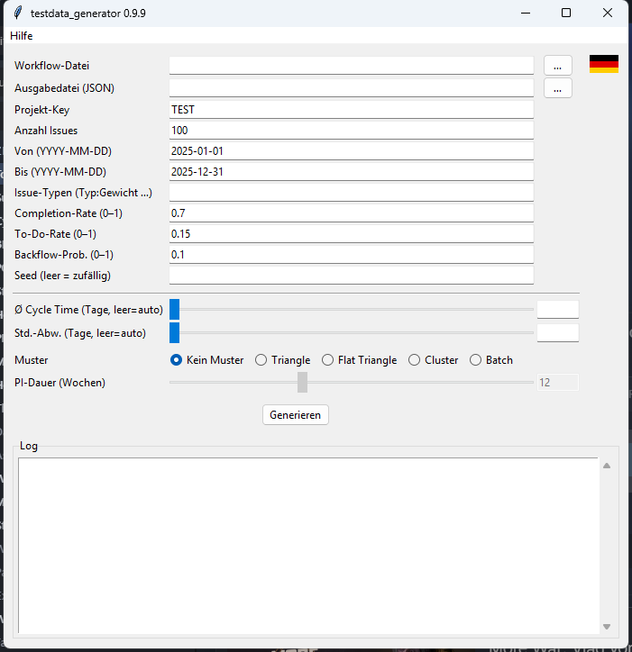

# testdata_generator

Generates synthetic Jira issue JSON files in Jira REST API format.
The generated files can be processed directly by `transform_data` and are
suitable for development, testing, and demonstrations without real Jira data.

**Status:** available (Beta)

## Manuals

| Language | Download |
|----------|----------|
| Deutsch (DE) | [Benutzerhandbuch](../testdata_generator_Benutzerhandbuch.pdf) |
| English (EN) | [User Manual](../testdata_generator_UserManual.pdf) |
| Română (RO) | [Manual de Utilizator](../testdata_generator_ManualUtilizator.pdf) |
| Português (PT) | [Manual do Utilizador](../testdata_generator_ManualUtilizador.pdf) |
| Français (FR) | [Manuel d'utilisation](../testdata_generator_ManuelUtilisateur.pdf) |

---

## Interface



## Start

### GUI

```bash
python -m testdata_generator
```

Or via the start script in the portable package:

- **Windows:** `TestdataGenerator.bat`
- **macOS:** `TestdataGenerator.command`
- **Linux:** `TestdataGenerator.sh`

### Command line

```bash
python -m testdata_generator \
    --workflow workflow_ART_A.txt \
    --project ART_A_GEN \
    --issues 200 \
    --seed 42 \
    --output ART_A_generated.json
```

## Parameters

| Parameter | Default | Description |
|-----------|---------|-------------|
| `--scenario portfolio` | (none) | Generate the complete demo portfolio instead of a single JSON (see below) |
| `--workflow FILE` | (required without `--scenario`) | Workflow definition file |
| `--output FILE.json` | `<project>_generated.json` | Output file |
| `--project KEY` | `TEST` | Jira project key |
| `--issues N` | `100` | Number of issues to generate |
| `--from-date YYYY-MM-DD` | `2025-01-01` | Earliest creation date |
| `--to-date YYYY-MM-DD` | `2025-12-31` | Latest transition date |
| `--issue-types TYPE:W …` | `Feature:0.6 Bug:0.3 Enabler:0.1` | Issue types with weights |
| `--completion-rate FLOAT` | `0.7` | Fraction of closed issues (0–1) |
| `--todo-rate FLOAT` | `0.15` | Fraction of open issues in To Do stages (0–1) |
| `--backflow-prob FLOAT` | `0.1` | Probability of backward transitions (0–1) |
| `--seed INT` | (random) | Seed for reproducible output |
| `--mean-cycle-days FLOAT` | (none) | Target mean cycle time in days (lognormal) |
| `--std-cycle-days FLOAT` | (30 % of mean) | Standard deviation of cycle time |
| `--pattern PATTERN` | `none` | Flow anti-pattern: `none` / `triangle` / `flat_triangle` / `cluster` / `batch` |
| `--pi-duration-weeks INT` | `12` | PI cycle length in weeks (for `cluster`/`batch`) |
| `--realism 0–100` | `0` | Untidiness of the stage paths (skips, cancels, parking, self-loops, reopening); about 70 is like a real ART |
| `--continue OLD.json` | (none) | Continue an earlier extract up to `--to-date` (since 0.39.0); `--issues` = number of NEW issues, `--rate-per-day` alternative |
| `--rate-per-day FLOAT` | (rate of the first window) | With `--continue`: new issues per day |
| `--learn-from FILE.xlsx` | (none) | Learn a transition profile from a real transitions file and stop (since 0.41.0); writes `<name>_profile.json` |
| `--transition-profile PROFILE.json` | (none) | Generate or continue with a learned profile: paths and dwell times from the data |

## Flow Patterns

Use `--mean-cycle-days` together with `--pattern` to simulate typical flow anti-patterns:

| Pattern | Description |
|---------|-------------|
| `none` | Random cycle time without shape (default) |
| `triangle` | Cycle time increases linearly over time — triangle shape in the scatter plot |
| `flat_triangle` | Like `triangle`, but the increase flattens toward the end (tanh) |
| `cluster` | Deliveries cluster in the last 2 weeks of each PI (Beta distribution) |
| `batch` | PI clustering with highly variable cycle time (0.1× to 3× mean) |

```bash
# Triangle pattern with mean cycle time of 30 days
python -m testdata_generator \
    --workflow workflow.txt \
    --pattern triangle \
    --mean-cycle-days 30 \
    --std-cycle-days 10 \
    --output triangle.json
```

## Portfolio scenario

**GUI:** the *Demo portfolio* section at the bottom of the window generates
the complete scenario into a folder of your choice (the seed field is
honoured, default 42) — **Open Portfolio Report** renders the portfolio
report, **Open Delta Briefing** renders the shipped
`snapshot_prev/now.json` pair into the "what changed?" briefing, and
**Open Conference Pre-Read** the VSC bundle — each opening in the
browser. Two clicks from empty folder to a full portfolio
evaluation, no command line needed.

**Command line:**

```bash
python -m testdata_generator --scenario portfolio --output demo/ --seed 42
```

Creates a complete, consistent demo portfolio in one step: two solutions with
three ARTs each, including every artifact of the processing chain — workflow
files, raw Jira JSON, `IssueTimes`/`CFD`/`Transitions` workbooks, two solution
configs (Solution Beta with its own `stage_map`, schema 2), a ROAM risk
register per solution (`risks_alpha.json`/`risks_beta.json`), an NFR/runway
register per solution (`nfr_alpha.json`/`nfr_beta.json`), a capability map
per solution (`capabilities_alpha.json`/`capabilities_beta.json`), a
dependency register per solution
(`dependencies_alpha.json`/`dependencies_beta.json`), a decision/assumption
log per solution (`decisions_alpha.json`/`decisions_beta.json`), a portfolio
config, a PI config, and a README describing the built-in stories. The data window is
placed relative to the generation date so the portfolio report's quality
traffic light rates the sources as current.

Built-in stories (deterministic per seed):

- **ART Alpha-3** is the outlier (~3× cycle time) — highlighted red in
  Solution Alpha's comparison report.
- **ART Beta-3** delivers weak data (no CFD, few started issues, data 60 days
  old) — confidence `low` in the quality table, coverage below 100 %.
- **Solution Beta** pools via its own `stage_map`; Solution Alpha uses the
  default classification path.
- **ROAM board**: both risk registers together hold nine risks; two owned
  risks are deliberately old (45/50 days) — the aging highlight fires.
- **NFR & runway**: six NFRs and four runway elements; Beta's API NFR is
  violated and one runway element is an overdue gap — the dashboard shows red.
- **Capability map**: six capabilities; Beta's data-insights capability is
  critical (weak source) and one Alpha capability has no contributing ART —
  flagged as uncovered.
- **Dependency heatmap**: five dependencies; Alpha-1 → Alpha-3 is blocked and
  overdue (the outlier does not deliver), and Beta-1 → Alpha-1 is a
  cross-solution integration — visible in the portfolio report.
- **Decision log**: three decisions and two assumptions; Alpha's stage-map
  decision supersedes an older one, and Beta's open assumption has passed
  its review date — flagged red as "review due".
- **Flow-problem backlog (B6, VSC)**: `flow_problems_alpha/beta.json` —
  FP-A1 and FP-B1 have survived 3 resp. 4 conferences (the workshop
  pattern "logged, never mitigated" — flagged red), FP-B1 is cross-VS;
  `--conference preread.html` renders the conference pre-read.
- **Strategic themes & roadmap (B7, VSC)**: `themes_alpha/beta.json` —
  Alpha's theme "Green operations" is orphaned (declared & forgotten),
  EP-A9 is a zombie initiative; the matrix shows trains ×
  P1·P2·Y1·Y2·Y3. In the delta briefing: EP-A9 lost its theme, EP-B2
  was pulled from P2 to P1 (*updated roadmaps*).
- **SLO & error budgets**: `slo_alpha.json`/`slo_beta.json` — Beta's
  "Order Sync API" breaches its SLO, Alpha's "Checkout" has nearly burned
  its budget (at risk).
- **DORA & code quality**: `dora_alpha.json`/`dora_beta.json` — ART
  Beta-3 is low tier in the delivery picture too (CFR 38 %, MTTR 30 h,
  coverage 31 %, rating D); producible/exchangeable via
  `python -m sources fetch` (providers: file, prometheus, github, gitlab,
  sonarqube — combinable).
- **Delta briefing**: `snapshot_prev.json` (the same world two weeks
  earlier) and `snapshot_now.json` ship with the scenario —
  `python -m portfolio --delta snapshot_prev.json snapshot_now.json` shows
  the throughput since, Beta-3's confidence decaying medium → low, AD-1
  escalating at_risk → blocked, risk BR-2 appearing, and the runway gap and
  assumption AS-B1 turning newly overdue.

The folder is directly usable: `python -m portfolio demo/portfolio.json`
builds the portfolio report; the solution configs also work individually.

### Configurable structure (beta, step 1a)

The structure of the data room is data, not code: `structure.json` lists
portfolios, their solutions and the ARTs of every solution; the workflow
(classic or own stage map) is a property of the solution. Three templates
ship — `small` (one solution with two ARTs), `standard` (the demo portfolio
above, byte-for-byte the same data) and `large` (five portfolios with three
to four solutions and one to six ARTs each, 49 ARTs in total). Solution names
are suggested (Alpha … Omega, then S25 …), ART names follow
`<Solution>-<n>`; all names are editable.

```bash
python -m testdata_generator --scenario portfolio --structure small --output demo/
python -m testdata_generator --scenario portfolio --arts 3,4s,1 --output demo/
python -m testdata_generator --scenario portfolio --structure my_structure.json --output demo/
```

`--arts` builds one portfolio from ART counts per solution (`s` = that
solution gets its own stage map). Before building, the CLI prints the
estimate (Jira exports, workbooks, registers) and warns from 30 ARTs or
five portfolios at scale `l` — it refuses nothing.

The story binds to **roles, not names** (`story.json` in the data room):
the outlier is the last ART of the first solution, the weak source the last
ART of the second, the blocked dependency and the recurring seam run from the
first to the last ART of the first solution, the cross-solution dependency
from the second solution's first ART to the first solution's first ART.
Renaming moves nothing. What the structure cannot provide is dropped with a
notice in the log, in `story.json` and in the README: a single solution has
no weak source and no cross-solution seam; a one-ART solution has no
outlier; a third and every further solution carries only the seed-generated
base population. Register IDs take the solution's first letter as tag
(`AR-1`, `BD-3`, `DP-G1`).

Several portfolios each get their own sub-folder with `portfolio.json`,
stands and README — every sub-folder is a complete data room; the root
holds the full `structure.json` and an index README. A picture across
portfolios is not a feature yet; the data for it is already laid out.

### Series of stands (beta, step 1b)

The data room ships a **series of stands** instead of two: `--stands N`
(2–12, default 6), two weeks apart, the last one on the reference date.
Every stand is a snapshot `snapshots/snapshot_<nn>_<date>.json`;
`snapshots/stands.json` indexes them (index, date, file), and
`snapshot_prev.json` / `snapshot_now.json` remain copies of the last two —
the GUI buttons, the tutorials and the continuation keep working unchanged.
Every consecutive pair comes as a rendered delta briefing under
`deltas/delta_<nn>-<nn+1>.md` and `.html`, so a training can open stand 1
and uncover the story stand by stand.

```bash
python -m testdata_generator --scenario portfolio --stands 6 --output demo/
python -m portfolio --delta demo/snapshots/snapshot_02_*.json demo/snapshots/snapshot_03_*.json
```

Each earlier stand is the same story two weeks younger: 88 % of the issues
per step and the registers before the "now" events. In the standard story
the turning points (blocked dependency, new risk, overdue runway gap,
confidence decay of the weak source) switch on with the last stand — the
earlier deltas show throughput and alarm movements only. Spreading the
events across the stands is what the story templates of step 2 add.
Continuing a data room (`--continue`) appends the new reference as the next
stand and renders its delta.

### Provider raw data (beta, step 1c)

Every solution gets a folder `sources/<solution>/` with what the external
systems would deliver — Prometheus instant-query responses, GitHub
deployments, statuses, pull requests and incident issues (first solution) or
GitLab DORA daily values (second solution), SonarQube component measures and
an SLO CSV — recorded as **replay files** in each system's own format, plus
the matching `sources` configs (`slo_sources.json`, `slo_sources_csv.json`,
`dora_sources.json`, `quality_sources.json`). The raw data is derived from
the registers, so the provider computes the same values back:

```bash
python -m sources fetch --kind slo --config demo/sources/alpha/slo_sources.json --output fetched_slo.json
python -m sources fetch --kind dora --config demo/sources/alpha/dora_sources.json --output fetched_dora.json
```

No network is used (`"replay"` in the config, see the sources module);
paths resolve relative to the config file. Prometheus, CSV, GitLab and
SonarQube come out exact; GitHub derives DORA from counts (deployments per
day = count / window, failure rate over a sample of at most 50 deployments,
medians of three recorded durations), so small units show coarse steps —
`github_expected()` names the values it will deliver, and the writer-vs-
reader test checks exactly that. Solutions whose registers carry no records
get no raw data (the log and the README say so).

### Story templates and event switches (beta, step 2)

The story of a data room is a template plus switches, written to
`story.json` (schema 2). Four templates ship:

| Template | What the stands show | Suggested stands |
|---|---|---|
| `calm` | No turning points: every ART delivers evenly, the registers hold base population and healthy anchors — the exercise is reading a picture that says nothing dramatic | 3 |
| `standard` | The demo story: outlier, weak source, SLO breach and the silent patterns from the start; blocked seam, cross-solution pressure, third solution area, confidence decay, new risk and updated roadmaps with the last stand | 6 |
| `escalation` | Pressure rises stand by stand: SLO breach early, blocked seam mid, confidence decay and cross-solution seams late, new risk and roadmaps last | 6 |
| `recovery` | Starts bad and heals: seams get resolved, the SLO holds again, the outlier finds its pace, the data source heals last — only the silent patterns remain | 6 |

Ten events (E1–E10) carry a **switch** and a **stand window** given as
phases (`start`, `early`, `mid`, `late`, `end`) that resolve to stand
indices for the chosen series length; the registers' anchors and the ART
profiles follow the events in force at each stand. Switch an event off and
its traces disappear everywhere: no outlier means the last ART delivers like
its sisters, no SLO breach means "Order Sync API" keeps its budget. An event
whose prerequisite is off (the confidence decay needs the weak source) stays
off with a notice.

```bash
python -m testdata_generator --scenario portfolio --story escalation --output demo/
python -m testdata_generator --scenario portfolio --story calm --event E6=on --output demo/
python -m testdata_generator --scenario portfolio --event E3=off --event E9=off --output demo/
```

The README lists every event with its stand window ("ab Stand 04", "Stand
01 bis 04") and marks switched-off events as "aus". The standard template
still produces exactly the data of before.

## Realistic stage paths (since 0.38.0)

A real ART does not walk neatly through every stage. Measured on the real ART_A (458 issues,
9 stages): 40 distinct transition pairs, 12 % backward, 7.5 % self-loops, 358 jumps over at
least one stage, 149 entries into the final stage without closing, median 4 transitions per
issue. The generator before 0.38.0 produced 11 pairs, 0 % loops, median 7.

`--realism` (0–100) scales eight disturbances of the path: jumps over stages, cancellations
straight into the final stage, parking in a side-track stage (recognised by name: Blocker,
Blocked, On Hold, Waiting …), self-loops, backflow over several stages, reopening, a start
outside the first working stage, and the move from closing into the final stage
(Releasing → Done). **0 is the previous behaviour** (only `--backflow-prob`), **about 70
matches the real ART_A** — the calibration is pinned by tests. Path and time are separate:
the disturbances apply in every mode, including the flow patterns, where the cycle time is
spread over the longer or shorter path.

The portfolio scenario builds its six ARTs with realism 60 since 0.38.0 (profile field
`realism`, overridable per ART). Seeds produce different data than before 0.38.0 — the
order of random draws changed.

## Continuation — the second extract (since 0.39.0)

A generated raw data set is an extract taken on T1. `--continue` produces the extract one
would have taken on T2 — exactly as if the data had been pulled manually twice:

```bash
python -m testdata_generator --workflow workflow.txt --continue ART_A.json --to-date 2026-03-01
```

- **The past is untouchable:** keys, creation dates and every transition up to T1 stay byte
  for byte; closed and cancelled issues are not touched at all.
- **Open issues move on:** new transitions after T1 under the same path and time model
  (realism, backflow, cycle time) until they finish or T2 is reached — whatever would fall
  after T2 stays open.
- **New issues** join in (T1, T2] with continuing keys; their number follows the rate of
  the first window, or `--issues N` / `--rate-per-day X`.
- **Reproducible:** the same seed and the same T2 give the same extract; a chain
  T1 → T2 → T3 keeps every earlier state in full.

For this the generator writes a `generator` record into the JSON envelope since 0.39.0
(cuts, seed, knobs, stages); `transform_data` reads only `issues` and is unaffected. A data
set without the record (older, or a real export) can be continued when the knobs are given —
T1 is then the youngest timestamp. Output: `<name>_<T2>.json` next to the source, or
`--output`. GUI: button **Continue…** next to **Generate** (To date and realism from the form).

**Whole data room (since 0.40.0):** `--scenario portfolio --continue demo/ --to-date T2`
continues the demo portfolio in place: every raw extract under `raw/` moves on (a stale
source such as Beta-3 stays exactly as stale), transform_data rewrites
IssueTimes/Transitions/CFD, solution, portfolio and PI configs move to T2 with the same
window length, and the snapshots rotate: the previous `snapshot_now.json` becomes
`snapshot_prev.json`, a new `snapshot_now.json` is frozen — the delta briefing then shows
real elapsed time instead of the staged two-week story. Registers stay unchanged.
GUI: **Continue Scenario…** (To date from the form).

## Learning from real data (since 0.41.0)

The knobs approximate a real ART; whoever has one uses it as the template. `--learn-from`
reads a transitions file from transform_data (XLSX or CSV: Key, Transition, Timestamp) and
estimates a **transition profile**: distribution of the first stage, first-order transition
matrix with an end state (where issues come to rest) and dwell times per source stage. The
profile holds **stage names, counts and hours only** — no keys, no texts, no dates. What is
generated with it shares nothing but the structure with the source.

```bash
python -m testdata_generator --learn-from ART_A_Transitions.xlsx --workflow workflow.txt
python -m testdata_generator --workflow workflow.txt --transition-profile ART_A_Transitions_profile.json --issues 500
```

With `--transition-profile` the stage path and the dwell times come from the profile;
realism, backflow, completion and to-do rate do not act on the path (the completion rate
follows from the data). `--mean-cycle-days` and the flow patterns stay in force: they spread
the cycle time over the learned path. The continuation uses the profile too when it is part
of the extract's knobs or passed along. GUI: field **Transition profile** and button
**Learn from Transitions…**. Learning with `--workflow` restricts the profile to that
workflow's stages; a profile with foreign stage names is rejected at generation time.

## Workflow file

Same format as in `transform_data`:

```
CanonicalStageName:Alias1:Alias2
<First>StageName
<Closed>StageName
```

## Output and further processing

```bash
# Generate
python -m testdata_generator --workflow workflow.txt --project ART_TEST --seed 1

# Process directly with transform_data
python -m transform_data ART_TEST_generated.json workflow.txt
```

The generated JSON file contains Jira changelog histories with status transitions
along the defined workflow. `transform_data` processes them into
`IssueTimes.xlsx`, `CFD.xlsx`, and `Transitions.xlsx`.

### Direct report (GUI)

After a successful generation the **"Create Report"** button becomes active in
the GUI. Clicking it runs `transform_data` and `build_reports` directly and
opens a combined report (a single HTML page with all metrics) in the browser.
The report covers the **entire generated date range** — no date filter.

## Architecture

```
testdata_generator/
├── __main__.py          Dispatcher: GUI without arguments, CLI with arguments
├── cli.py               run_generate() + argparse CLI
├── generator.py         # Core logic: issue simulation (time onto the path)
├── paths.py             # Stage paths: realism disturbances, parking stage (0.38.0)
├── continuation.py      # Continuation: second extract, envelope record (0.39.0)
├── scenario_continue.py # Scenario continuation with snapshot rotation (0.40.0)
├── learn.py             # Transition profile from real transitions (0.41.0)
└── workflow_parser.py   Re-export from transform_data.workflow
```

## Tests

```bash
python -m pytest tests/testdata_generator/
```

## Note: Random cycle time distribution

The generator ensures that completed issues close **before** the configured `to-date`. The creation date is sampled from a restricted window `[from-date, latest_start]` where `latest_start` leaves enough buffer for the maximum cycle time. This produces an evenly distributed, random point cloud in the Flow Time scatter plot rather than a descending diagonal (right-censoring artefact).
