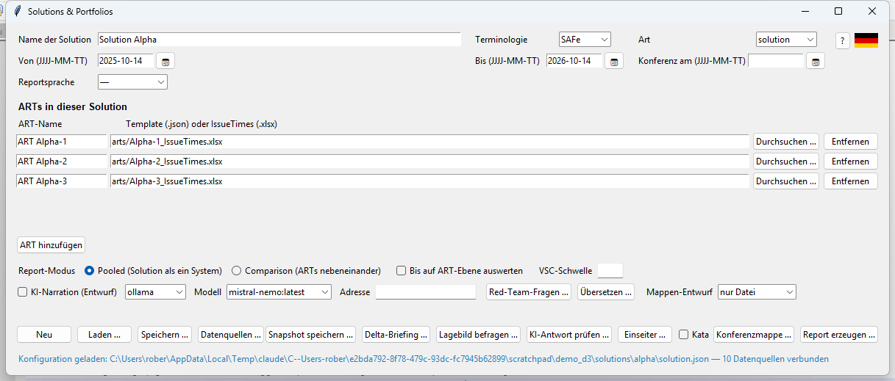
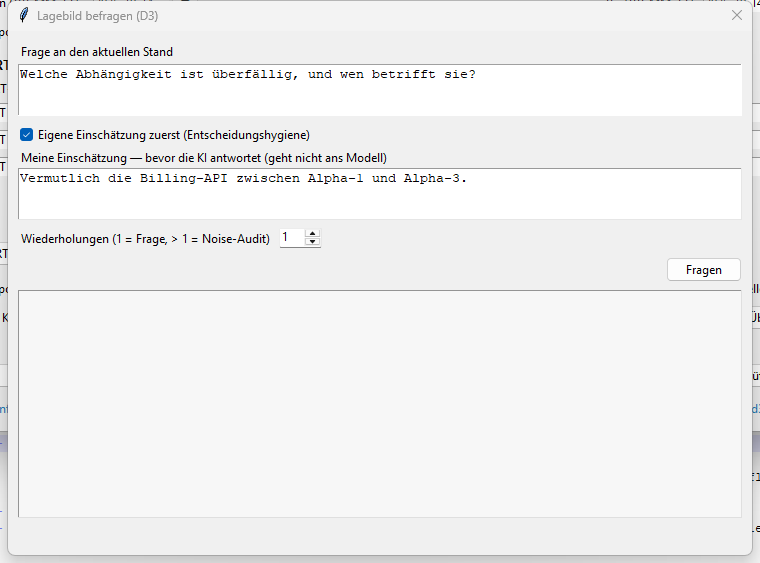
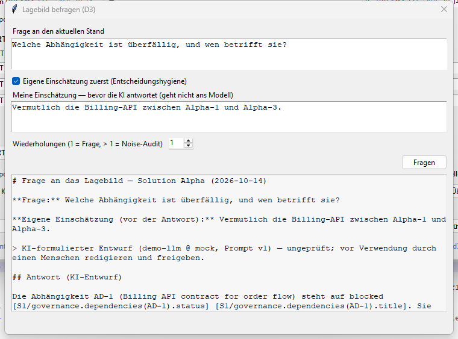

# Asking the situational picture (D3) — step by step

**Audience:** anyone who works with a solution or portfolio situational picture and wants
to ask questions about the current stand — no Python or AI background needed.
**Time:** about 45 minutes, five of them for the demo portfolio.
**You need:** SituationReport 0.46.0 or later; for real model answers a local Ollama
(see [Install Ollama](install-ollama.md)) — to learn the flow, the built-in provider
`mock` is enough and needs no model.
**At the end:** you ask questions about a stand, read answers with citations, recognise
discarded answers and know why they were discarded.

This tutorial is also available as a PDF: [DE](../ask_Tutorial_DE.pdf) / [EN](../ask_Tutorial_EN.pdf).

---

## 1. What it is — and what it is not

A situational picture has many numbers and registers: metrics per ART, risks,
dependencies, flow problems, solution areas. Whoever has a concrete question ("Which
dependency is overdue?") so far searched the report. **"Ask the picture"** lets a language
model answer that question — under one condition the tool enforces:

> **Every statement of the answer cites the data path it comes from. A statement without a
> citation, a citation of a path that does not exist, or a number that is not in the cited
> facts causes the whole answer to be discarded.**

So the model may only say what it can cite. When it knows nothing, the permitted answer is
verbatim: *"The situational picture holds no information on that."*

What "Ask the picture" is **not**:

- **Not a chat.** Every question goes anew against the stand; there is no conversation
  memory. Follow-up questions carry their own context ("… and who receives AD-1?" becomes
  "Who is the receiving ART of dependency AD-1?").
- **Not a recommendation.** The answer explains what the stand holds. It does not say what
  to do. Judgement stays with humans.
- **No web search, no external sources.** The model receives the stand and nothing else.
- **No persons.** Owner and reporter fields never reach the model; participants are teams,
  ARTs and value streams.

---

## 2. Ready in five minutes

### 2.1 Generate the demo portfolio

You need data. The test-data generator builds a complete demo portfolio with two
solutions, six ARTs, every register and two snapshots:

```bash
python -m testdata_generator --scenario portfolio --output demo --seed 42
```

In the GUI: open the Testdata Generator, click **"Generate demo portfolio …"** in the
"Demo portfolio" section at the bottom and choose a target folder.

Afterwards the folder is a complete data room:

```text
demo/
├── portfolio.json              ← the portfolio (two solutions)
├── solutions/alpha/solution.json   ← Solution Alpha (three ARTs, every register)
├── solutions/alpha/registers/      ← risks.json, dependencies.json, flow_problems.json, …
├── solutions/beta/solution.json
├── snapshots/snapshot_prev.json    ← stand of two weeks ago
├── snapshots/snapshot_now.json     ← current stand
└── README.md                       ← the story the data tells
```

In this tutorial we ask **Solution Alpha** (`demo/solutions/alpha/solution.json`). Its
story in two sentences: dependency AD-1 between ART Alpha-1 and ART Alpha-3 is blocked
and overdue since 29 September; the same seam has opened a solution area on the test
environment topic for the third time.

### 2.2 Choose a provider

The language model is exchangeable (a "provider"). For this tutorial:

| Provider | What it does | When to use it |
|---|---|---|
| `mock` | No model. Answers every question with the unknown sentence. | Learn the flow, the files and the evidence — right now, without installing anything |
| `ollama` | A local model on your machine; nothing leaves it. | Real answers. Run `ollama pull mistral-nemo` first |
| `claude` | The Anthropic API; key only from the environment variable `ANTHROPIC_API_KEY`. | When an external service is permitted |
| `export` | No model. Writes the complete prompt to a file (for another machine). | Chapter 10 |

Chapters 4 to 6 show `mock` first, then an answer the way a real model gives it.

---

## 3. Five terms you need

**Stand.** The situational picture at one point in time: metrics, sources, every register.
Technically a snapshot. You always ask *one* stand — the current one (live from the config)
or a saved one.

**Fact index.** Before the answer, the stand is split into single **facts**. Every fact has
a **path**, a value, a label and the date of the stand. The index is the only text the model
sees. Solution Alpha has 527 facts today.

**Path.** The address of a fact. It is built like this:

```text
S1/governance.dependencies(AD-1).status
│  │          │            │     └── the field
│  │          │            └──────── the entry's key (in parentheses)
│  │          └───────────────────── the register
│  └──────────────────────────────── the area
└─────────────────────────────────── the stand: S1 = current, S0 = previous,
                                     D = change S1 minus S0, H = harmonisation
```

The path families with real examples from Solution Alpha:

| Path | Means | Example value |
|---|---|---|
| `S1/total.items` | pooled metric of the whole solution | `360` |
| `S1/units(ART Alpha-1).items` | metric of one unit | `120` |
| `S1/sources(ART Alpha-1).confidence` | data quality of the source | `high` |
| `S1/governance.dependencies(AD-1).status` | field of a register entry | `blocked` |
| `S1/governance.dependencies(AD-1).due` | due date | `2026-09-29` |
| `S1/governance.flow_problems(FP-A1).conferences` | how often the flow problem has been on the conference | `3` |
| `S1/governance.solution_areas.seams(ART Alpha-1 x ART Alpha-3).recurrence` | recurrence per seam (P5) | `3 (topic: test environment)` |
| `S0/total.median_ct` | the same fact in the previous stand | only with a previous stand |
| `D/total.open` | change between the stands | `+29` |
| `H/process(Order-to-Cash).business_value.score` | harmonisation score | only with an attached workspace |

Metrics are called `items`, `completed`, `open`, `median_ct`, `p85_ct`, `p95_ct`,
`target_ct_pct`, `median_lt`. Register fields carry the names from the JSON files
(`status`, `due`, `from`, `to`, `title`, `topic`, …). Free text such as `title` is marked
with `text:` and cut at 160 characters — it is data, not an instruction.

**Citation.** A path in square brackets at the end of a statement:
`[S1/governance.dependencies(AD-1).status]`. Keys sit in **parentheses** so that the
citation itself contains no square brackets.

**Citation guard.** The check after the answer. It splits the answer into statements (list
lines, sentences) and checks each: is there a citation? does the path exist? are all numbers
of the statement in the cited facts? One violation discards the answer.

---

## 4. The first question in the GUI

### 4.1 Load the solution

Open **Solutions & Portfolios** (launcher or `python -m portfolio`), click **"Load …"** and
choose `demo/solutions/alpha/solution.json`.



In the **AI narration** row you choose the provider (`mock`, `ollama`, `claude`,
`export`) and, for Ollama, the model. The "AI narration (draft)" checkbox does not matter
for questions — the dialog always uses the selected provider.

### 4.2 Open the dialog

Click **"Ask the picture …"**.



The fields from top to bottom:

1. **Question about the current stand** — your question in full sentences. Name things the
   way the picture names them (ART names, register IDs such as `AD-1`, terms such as
   "dependency", "flow problem", "solution area").
2. **Own assessment first** — checkbox and field. What you yourself believe *before* the AI
   answers. Never sent to the model (chapter 8).
3. **Repeats** — `1` is a normal question. More than 1 starts a noise audit (chapter 11).
4. **Ask** — starts the run. First you are asked where to save the answer file (suggested
   `Solution Alpha_Frage_<date>.ask.md`).
5. **Answer box** — shows banner and answer, or the violations when the answer was discarded.

### 4.3 Ask and read

Type: *Which dependency is overdue, and whom does it affect?* — and click **Ask**. The status
line shows the run. Local models need 30 to 120 seconds; `mock` answers at once.



With `mock` the answer box reads:

```text
AI-drafted (mock-1 @ mock, Prompt v1) — unreviewed draft; a human must edit and approve
before use.

The situational picture holds no information on that.
```

That is correct: `mock` is a stand-in without a model and must not claim anything. The
unknown sentence is the only answer that is valid without a citation. With a real model the
answer of chapter 5 appears here.

---

## 5. Reading an answer — line by line

This is the saved file `Solution Alpha_Frage_2026-10-14.ask.md` (German UI; the structure is
identical in English). The answer text in this tutorial was **written by hand** so that the
example reads well; it was then checked by the citation guard like a model answer and
passed. A local model answers similarly, in its own words.

```markdown
# Frage an das Lagebild — Solution Alpha (2026-10-14)

**Frage:** Welche Abhängigkeit ist überfällig, und wen betrifft sie?

**Eigene Einschätzung (vor der Antwort):** Vermutlich die Billing-API zwischen Alpha-1 und Alpha-3.

> KI-formulierter Entwurf (demo-llm @ mock, Prompt v1) — ungeprüft; vor Verwendung durch
> einen Menschen redigieren und freigeben.

## Antwort (KI-Entwurf)

Die Abhängigkeit AD-1 (Billing API contract for order flow) steht auf blocked
[S1/governance.dependencies(AD-1).status] [S1/governance.dependencies(AD-1).title].
Sie war am 2026-09-29 fällig [S1/governance.dependencies(AD-1).due], der Stand ist vom
2026-10-14 [S1/total.items]. Betroffen sind ART Alpha-1 als Geber und ART Alpha-3 als
Nehmer [S1/governance.dependencies(AD-1).from] [S1/governance.dependencies(AD-1).to].
Dieselbe Naht hat zum dritten Mal eine Solution Area zum Thema test environment
eröffnet [S1/governance.solution_areas.seams(ART Alpha-1 x ART Alpha-3).recurrence].

---
Stand: S1 = 2026-10-14 · Fakten im Index: 527 · Index-Prüfsumme (SHA-256): 43aa08d6… ·
Modell: demo-llm @ mock · own-view hash: 56dc697e80339a25
```

What the parts mean:

| Line | Meaning |
|---|---|
| Heading | solution and stand you asked |
| **Question** | your question, cleaned (control characters removed, 500 characters at most) |
| **Own assessment** | your text from before the answer — or "— (skipped)" |
| Banner (`>`) | mandatory label: model, deployment class (`local`, `remote`, `mock`), prompt version. Stays until a human edits and approves the text |
| Answer | every statement ends with one or more citations |
| Footer | stand (S1, S0 if any), number of facts, checksum of the index (so it is traceable **which** stand the model saw), model, hash of your assessment |

### Looking up a citation

Take `[S1/governance.dependencies(AD-1).due]`. That is: current stand, register
`dependencies`, entry `AD-1`, field `due`. In the data room you find the entry in
`demo/solutions/alpha/registers/dependencies.json`:

```json
{"id": "AD-1", "title": "Billing API contract for order flow",
 "from": "ART Alpha-1", "to": "ART Alpha-3", "status": "blocked", "due": "2026-09-29", ...}
```

The number `2026-09-29` in the answer is exactly there. That is the whole trick: every
statement has an address, and the address leads to a file you can open.

The complete fact index with all 527 paths is yours when you pick the provider `export`
(chapter 10): the prompt bundle contains it in full.

### Why two citations behind one statement?

"Dependency AD-1 (Billing API contract for order flow) is blocked" names two facts — the
title and the status. Both are cited. The guard demands *at least* one citation per
statement; more are allowed and often necessary so that every number and value is backed.

---

## 6. The same question on the command line

```bash
python -m portfolio demo/solutions/alpha/solution.json \
    --ask "Which dependency is overdue, and whom does it affect?" \
    --narrate ollama --llm-lang en
```

Output:

```text
Question to stand 2026-10-14 via 'ollama' (527 facts) ...
Answer written (draft for human review): demo/solutions/alpha/solution_2026-10-14.ask.md
```

The file sits next to the config; `llm_audit.jsonl` appears beside it (chapter 12).

| Flag | Meaning |
|---|---|
| `--ask "…"` | the question |
| `--narrate PROVIDER` | `ollama` (default when given without a value), `claude`, `mock`, `export` |
| `--llm-model NAME` | the provider's model, e.g. `mistral-nemo` |
| `--llm-base-url URL` | address of a remote Ollama (then class `remote`) |
| `--llm-lang de|en` | answer language (default `de`) |
| `--own-view "…"` | own assessment before the answer (chapter 8) |
| `--ask-snapshot FILE` | ask a saved stand instead of the current one (chapter 9) |
| `--since-snapshot FILE` | add the previous stand → paths `S0/…` and `D/…` (chapter 9) |
| `--ask-scope all|metrics|registers` | which facts enter the index (default `all`) |
| `--ask-output FILE` | where the `.ask.md` goes |
| `--noise N` | noise audit with N repeats (chapter 11) |

Exit codes: `0` answer written, `3` answer discarded (nothing written).

---

## 7. When an answer is discarded

This will happen to you, especially with small local models. It is not a defect of the tool
— it is the tool doing its job. Two real messages:

**Numbers guard** (a number that occurs nowhere in the stand):

```text
REJECTED: Narration discarded: the model invented number(s) 45 that do not occur in the
briefing. The LLM writes, it does not calculate — re-run, switch the model, or use the
deterministic briefing as is.
```

**Citation guard** (a statement without a citation):

```text
REJECTED: Answer discarded: every statement must cite a fact path of the stand and every
number must come from the cited facts. 1 violation(s): uncited: Die Abhängigkeit AD-1
ist blockiert und sollte eskaliert werden.
```

Note the second example: the statement was even correct (AD-1 is blocked) — but it carried
no citation and contained a recommendation ("should be escalated"). Neither may pass.

The three kinds of violation:

| Message | Means |
|---|---|
| `uncited: …` | a statement without `[path]` |
| `unknown path: …` | a citation of a path the index does not have (usually a typo by the model) |
| `number not in cited facts: …` | a number that occurs somewhere in the stand but not in the facts the statement cites |

What you can do — in this order:

1. **Ask again.** Models scatter; the second run is often clean.
2. **Sharpen the question.** "What about the dependencies?" invites storytelling;
   "Which dependencies have the status blocked?" leads to citations.
3. **Larger model.** Small models forget the citation rule more easily.
4. **Stay with the deterministic report.** The number is in the report, with or without AI.

In the dialog the violations appear in the answer box, the status line says "Answer
discarded". On the command line the exit code is `3`. In both cases **no answer file is
written**, but the evidence (chapter 12) records the run with `guard_passed: false`.

---

## 8. Own assessment first

Whoever reads an AI's answer before thinking for themselves adopts its view without noticing.
Decision research calls this anchoring; the AI memorandum makes it principle 7: **judge
independently first, then ask the AI.**

That is why the dialog has the field **"My assessment — before the AI answers"**:

- The checkbox is on by default. Removing it is a deliberate click; this machine remembers
  the setting (not the solution config).
- What you write there **never reaches the model**. It sits in the answer file above the AI
  answer — so you see both side by side.
- The evidence records only a hash of your assessment, not the text.

On the command line: `--own-view "Probably the billing API between Alpha-1 and Alpha-3."`

A good use: before the value-stream conference every staff member notes their assessment
of the same question. Then one of them asks the AI. Where the assessments diverge is where
the conversation is — not the AI answer.

---

## 9. Asking about the change

So far you asked one stand. With a previous stand two path families join: `S0/…` (the same
fact in the previous stand) and `D/…` (the change, S1 minus S0).

```bash
python -m portfolio demo/portfolio.json \
    --ask "What has changed since the last stand?" \
    --ask-snapshot demo/snapshots/snapshot_now.json \
    --since-snapshot demo/snapshots/snapshot_prev.json \
    --narrate ollama --llm-lang en
```

Here **the whole portfolio** is asked, with a saved stand (`--ask-snapshot`) and a previous
stand (`--since-snapshot`). The index grows to 1,882 facts; among them now lines like these:

```text
- [D/total.items] change of items = +83 (as of 2026-09-30 -> 2026-10-14; Demo Portfolio)
- [D/total.completed] change of completed = +54 (as of 2026-09-30 -> 2026-10-14; Demo Portfolio)
- [D/total.open] change of open = +29 (as of 2026-09-30 -> 2026-10-14; Demo Portfolio)
- [D/total.median_ct] change of median_ct = -0.1 (as of 2026-09-30 -> 2026-10-14; Demo Portfolio)
- [D/units(Solution Alpha).items] change of items = +45 (as of 2026-09-30 -> 2026-10-14; Demo Portfolio)
```

An answer could read: "The portfolio gained 83 items [D/total.items], 45 of them at Solution
Alpha [D/units(Solution Alpha).items]." The file footer then names both stands:
`S1 = 2026-10-14, S0 = 2026-09-30`.

Two notes:

- The GUI dialog always asks the **current** stand without a previous one. For questions
  about change use the command line.
- Saved stands come from **"Save snapshot …"** or `--snapshot FILE`. Whoever saves the stand
  before asking can later trace **exactly** what the model saw — the index checksum in the
  footer is then reproducible.

---

## 10. No model on this machine: export the prompt and check the answer on return

Is no model allowed on your machine, or do you want to use another model elsewhere? Then pick
the provider `export`:

```bash
python -m portfolio demo/solutions/alpha/solution.json \
    --ask "Which dependency is overdue?" --narrate export
```

Instead of an answer, `prompt_d3_question_<timestamp>.md` appears next to the output (and the
text is on the clipboard). The bundle holds the instructions, the system prompt and, as
"input", the **complete fact index** — exactly what a model would have seen here. Run it on
the other machine, save the answer as a file and bring it back:

```bash
python -m llm check answer.md --model "gpt-something"
```

`llm check` finds the bundle next to the answer, runs **the same guards** — numbers and, as it
is a D3 question, the citations too — and on a pass writes `answer.md.checked.md` with the
banner "Externally produced AI draft". On a reject nothing is written. The evidence links
outward and return path through the same input checksum. In the GUI: button **"Check AI
answer …"**.

---

## 11. How loud is the model? The noise audit

A language model does not answer the same question the same way twice. Before you trust an
answer, the counter-check is worth it: the same question several times, slightly rephrased,
against the same stand.

In the dialog: set **Repeats** to `5` and click **Ask**. On the command line: `--noise 5`.

Run 1 is your question unchanged, then fixed rephrasings follow ("In short: …", "For the
value-stream conference: …", …). The protocol `….noise.md` begins like this (here with
`mock`, hence "no information" everywhere; German UI):

```markdown
# Noise-Audit — Solution Alpha (2026-10-14)

**Frage:** Wie steht es um die Abhängigkeiten?

Die Streuung ist ein Befund über das Modell und die Frage, kein Urteil über die Lage.
Was daraus folgt, entscheidet der Mensch.

## Läufe (3)

| Lauf | Variante | Modell | Zitate | Zahlen | Ergebnis |
|---|---|---|---|---|---|
| 1 | Wie steht es um die Abhängigkeiten? | mock-1 | 0 | - | keine Angabe |
| 2 | Kurz gefasst: Wie steht es um die Abhängigkeiten? | mock-1 | 0 | - | keine Angabe |
| 3 | Für die Value-Stream-Konferenz: Wie steht es um die Abhängigkeiten? | mock-1 | 0 | - | keine Angabe |

## Zitier-Konsistenz (mittlere paarweise Jaccard-Ähnlichkeit)

**100.0 / 100**
```

Reading the measures:

| Measure | Means | How to read it |
|---|---|---|
| Citation consistency | how similar the cited path sets of the answers are, 0–100 | 100 = all cite the same; below 50 every answer cites something else |
| Core | paths the majority of valid answers cite | what the model reliably relies on |
| Scatter | paths only one answer cites — with that statement | what a single rephrasing brought up |
| Number conflicts | the same path, different numbers in different answers | should be empty; otherwise the model reads the index sloppily |
| no information / rejected | shares of the runs | high rates mean: question or model do not fit the stand |

The protocol does not judge. Whether 70 is "good enough" depends on what you intend to do
with the answer. A discarded answer is **not retried** — that the model falls out of the
contract on a rephrasing is part of the finding.

With `--views staff.txt` (one assessment per paragraph) the staff assessments are listed,
numbered, below the AI core — without any evaluation by the tool.

---

## 12. The evidence

Every run, passed or discarded, appends one line to `llm_audit.jsonl` next to the output:

```json
{"ts": "2026-10-14T14:45:48", "purpose": "d3_question", "provider": "demo",
 "model": "demo-llm", "deployment_class": "mock", "prompt_version": "v1",
 "input_sha256": "6c565e86…", "output_sha256": "b49cb706…", "duration_s": 0.0,
 "guard_passed": true}
```

It holds **hashes only** — neither the question nor the answer nor your assessment in clear
text. `input_sha256` proves which contract (question plus index) went to the model;
`guard_passed` says whether the answer got through. This is the operator evidence the EU AI
Act asks of you — without you having to do anything for it.

---

## 13. Troubleshooting

| Observation | Cause and remedy |
|---|---|
| "The situational picture holds no information on that." on every question | Provider `mock` selected — it has no model. Switch to `ollama`. Or: the question concerns something no register holds (persons, budgets) |
| `REJECTED: … uncited: …` | Chapter 7. Ask again, sharpen the question, larger model |
| `REJECTED: … invented number(s) …` | The model computed or estimated. Same procedure |
| `Could not reach Ollama` | Ollama is not running. Start it and wait for the tray icon |
| The run takes "forever" | Local models compute 30–120 seconds; the index is large with 500+ facts. `--ask-scope metrics` or `registers` shrinks it |
| The answer names a person | Cannot come from the index — it holds no person fields. The model invented it; discard the answer even though the guard let it pass because no number was violated |
| Answer in the wrong language | set `--llm-lang`; in the dialog the language follows the GUI |
| The dialog is missing in the GUI | check the version: "Ask the picture …" exists since 0.46.0, "Repeats" since 0.47.0 |

---

## 14. What to take away

- **You ask a stand, not a model.** The model phrases; the facts come from the picture, and
  every statement carries its address.
- **A discarded answer is the tool succeeding**, not failing. Better no answer than one with
  an invented number.
- **Judge first, then ask.** The assessment field is not a form, it is your anchor against
  the AI's.
- **Measure the spread before you trust.** Five repeats cost two minutes and show how firmly
  the answer stands.
- **Nothing leaves your house without approval.** The banner stays until a human removes it
  deliberately.

---

## Appendix: questions that work well

Questions aimed at registers and fields get citations; questions about reasons and advice get
the unknown sentence or are discarded.

| Good | Less good |
|---|---|
| Which dependencies have the status blocked? | Why are the dependencies blocked? |
| How many items are open at ART Alpha-3? | Is Alpha-3 too slow? |
| Which flow problem has been on the conference most often? | What should we do about the flow problem? |
| At which seam are there recurring solution areas? | Should we merge Alpha-1 and Alpha-3? |
| How did the median cycle time change since the previous stand? | Is it getting better? |
