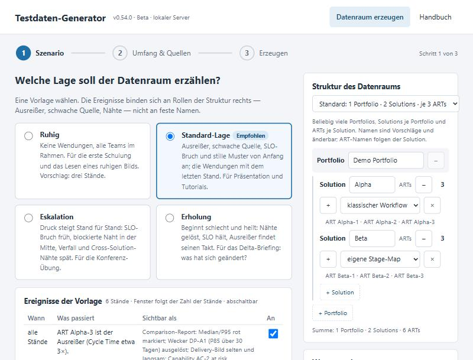
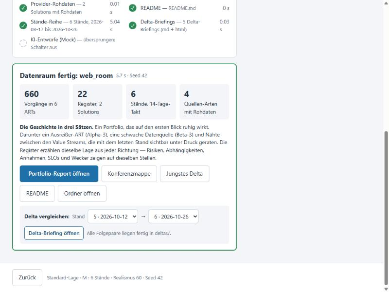

# Demo-Datenraum in einer Minute — Schritt für Schritt

**Zielgruppe:** Trainer, Vorführende und Testnutzer, die ein vollständiges Demo-Portfolio
mit einer erzählbaren Lage brauchen — ohne Vorkenntnisse in Python.
**Dauer:** eine Minute bis zum ersten Datenraum, rund 30 Minuten für das ganze Tutorial.
**Voraussetzungen:** SituationReport (Beta-Stand mit Testdaten-Generator 3), ein Browser.
Es wird nichts installiert; der Generator braucht kein Netz und kein Modell.
**Am Ende:** du erzeugst einen Datenraum per Knopfdruck, wählst Geschichte und Struktur,
liest die Stände-Reihe und weißt, welche Datei wofür da ist.

Dieses Tutorial gibt es auch als PDF: [DE](../dataspace_Tutorial_DE.pdf) /
[EN](../dataspace_Tutorial_EN.pdf).

---

## 1. Worum es geht — und worum nicht

Ein **Datenraum** ist ein Ordner, der alles enthält, was die Suite für ein Portfolio lesen
kann: Jira-Exporte je ART, die Arbeitsmappen daraus, Register je Solution (Risiken,
Abhängigkeiten, NFRs, Capabilities, Entscheidungen, SLOs, Delivery, Flussprobleme, Themes,
Solution Areas, Wecker), Konfigurationen, eine Reihe eingefrorener Stände mit den
Delta-Briefings dazwischen, die Rohdaten der Provider und eine README, die die Geschichte
erzählt. Der Portfolio-Manager liest ihn so, wie er einen echten Datenraum liest.

Der Generator erzeugt einen **Demo-Datenraum**: dieselbe Form, erfundene Teams, eine
gewählte Geschichte. Drei Dinge gelten immer:

- **Keine Personen.** Owner und Melder sind Teams, ARTs und Value Streams.
- **Reproduzierbar.** Gleicher Seed, gleiche Struktur, gleiche Geschichte, gleiches
  Referenzdatum — gleicher Datenraum.
- **Die Register sind die Wahrheit.** Rohdaten und Stände werden aus ihnen abgeleitet, nie
  umgekehrt.

Was der Demo-Datenraum **nicht** ist: ein Abbild eines echten Unternehmens. Die Zahlen
sind plausibel, aber erfunden; die Geschichte ist eine Vorlage, keine Beobachtung.

---

## 2. In einer Minute: die Browser-Oberfläche

### 2.1 Starten

```bash
python -m testdata_generator --web
```

Es öffnet sich dein Browser mit einer Adresse wie `http://127.0.0.1:51347/3f9a…/`. Die
Seite läuft auf einem kleinen Server **nur auf deinem Rechner** (Adresse 127.0.0.1, zufälliger
Port, Zufallsschlüssel im Link). Wer den Link nicht hat, bekommt eine 403-Seite; aus dem
Netz ist nichts erreichbar. Beenden mit Strg+C im Fenster, aus dem du gestartet hast.

Die Oberfläche ist Deutsch oder Englisch (`--lang de`); mit `--no-browser` druckt der
Generator nur den Link, mit `--port 8765` nimmt er einen festen Port.

Ohne Kommandozeile: im Launcher (`SituationReport.bat`) die Karte **„Datenraum (Browser)"**
starten; im tragbaren Paket liegt dafür auch `DatenraumBrowser.bat` (macOS/Linux:
`DatenraumBrowser.command` / `.sh`).

### 2.2 Schritt 1 — Szenario



Links wählst du die **Vorlage**. „Standard-Lage" ist empfohlen: ein Ausreißer-ART, eine
schwache Datenquelle, ein SLO-Bruch und die stillen Muster von Anfang an; blockierte Naht,
Cross-Solution-Druck, dritte Solution Area, Konfidenz-Verfall, neues Risiko und geänderte
Roadmaps mit dem letzten Stand. Darunter stehen die **Ereignisse** der Vorlage mit ihrem
Stand-Fenster und einem Schalter — für die erste Minute lässt du alles so.

Rechts steht die **Struktur**: ein Portfolio, zwei Solutions, je drei ARTs. Auch das lässt
du für die erste Minute so. „Was entsteht" zeigt die Zahlen, die aus der Struktur folgen.

Klicke **Weiter zu Umfang & Quellen**.

### 2.3 Schritt 2 — Umfang und Quellen

Die Vorgaben reichen: sechs Stände im 14-Tage-Rhythmus, Umfang M, Realismus 60, Seed 42,
letzter Stand heute, Sprache der Texte wie die Oberfläche. Rechts siehst du, welche Quellen
immer dabei sind; der Schalter **KI-Entwürfe** bleibt aus.

Klicke **Weiter zu Erzeugen**.

### 2.4 Schritt 3 — Erzeugen

Der **Zielordner** ist vorgeschlagen (ein neuer Ordner in deinem Benutzerverzeichnis).
Ändere ihn mit „Durchsuchen …" oder tippe einen Pfad. Dann **Datenraum erzeugen**.

Die Fortschrittsliste zeigt die neun Teilschritte mit Dauer: Struktur und Geschichte,
Jira-Exporte und Arbeitsmappen, Register, Konfigurationen, Provider-Rohdaten, README,
Stände-Reihe, Delta-Briefings, KI-Entwürfe (übersprungen, Schalter aus). Nach wenigen
Sekunden erscheint die Ergebniskarte.



Die vier Zahlen: Vorgänge in 6 ARTs, 22 Register in 2 Solutions (11 je Solution), 6
Stände, 4 Quellen-Arten mit Rohdaten. Darunter die Geschichte in drei Sätzen. Die Knöpfe
öffnen den Portfolio-Report, die Konferenzmappe, das jüngste Delta-Briefing, die README und
den Ordner; der Vergleichswähler öffnet das Delta zwischen zwei beliebigen Ständen.

Das war die Minute. Alles Weitere ist Lesen und Variieren.

---

## 3. Dasselbe auf der Kommandozeile

```bash
python -m testdata_generator --scenario portfolio --output demo --seed 42
```

Das erzeugt exakt denselben Datenraum wie die Oberfläche mit den Vorgaben. Die Schalter
der drei Schritte heißen hier:

| Oberfläche | Kommandozeile |
|---|---|
| Vorlage | `--story calm\|standard\|escalation\|recovery` |
| Ereignis an/aus | `--event E3=off` (wiederholbar) |
| Struktur-Vorlage | `--structure small\|standard\|large` oder `--structure DATEI.json` |
| ART-Zahl je Solution | `--arts 3,4s,1` (`s` = eigene Stage-Map) |
| Stände | `--stands 6` |
| Umfang | `--scale s\|m\|l` |
| Seed | `--seed 42` |
| KI-Entwürfe | `--ai-drafts` |

Vor dem Bau druckt die Kommandozeile die Schätzung („6 Jira-Exporte, 18 Arbeitsmappen,
22 Register, 6 Stände, 5 Delta-Briefings") und warnt bei großen Strukturen; danach die
Ergebniszeile mit Vorgängen, Registern, Ständen, Deltas und Dauer.

---

## 4. Was im Ordner liegt

```text
demo/
├── structure.json · story.json   ← Struktur und Geschichte als Daten
├── portfolio.json                ← Einstieg für den Portfolio-Manager
├── solutions/alpha/solution.json ← je Solution: Config, arts/, registers/
├── solutions/beta/…
├── workflows/  raw/  pi_config.json
├── sources/alpha/ · sources/beta/ ← Provider-Rohdaten + sources-Configs
├── snapshots/snapshot_01_… bis _06_…, stands.json, snapshot_prev/now.json
├── deltas/delta_01-02.md/.html … delta_05-06
└── README.md                     ← Struktur, Geschichte, Stände, Quellen, Befehle
```

Lies zuerst die **README**: sie zählt die Solutions mit ihren ARTs, die Ereignisse der
Geschichte mit Stand-Fenster, die Stände mit Datum und Datei und die Quellen mit den
Befehlen. Wer den Ordner weitergibt, gibt die Erklärung mit.

Der Ordner ist **verschiebbar**: alle Pfade in den Configs sind relativ. Kopieren, zippen,
auf einen anderen Rechner legen — der Portfolio-Manager liest ihn dort genauso.

---

## 5. Die Geschichte wählen

Vier Vorlagen, dieselbe Struktur, andere Ereignisse:

| Vorlage | Für wen | Was die Stände zeigen |
|---|---|---|
| **Ruhig** | die erste Schulung | keine Wendungen; die Übung ist, ein Bild zu lesen, das nichts Dramatisches sagt — wer hier Alarm schlägt, hat überlesen |
| **Standard-Lage** | Präsentation, Tutorials | die Wendungen mit dem letzten Stand; davor Durchsatz und Wecker-Bewegungen |
| **Eskalation** | die Konferenz-Übung | SLO-Bruch früh, blockierte Naht in der Mitte, Verfall und Cross-Solution-Nähte spät, neues Risiko zuletzt |
| **Erholung** | das Delta-Briefing | beginnt schlecht und heilt: Nähte gelöst, SLO hält, Ausreißer findet seinen Takt, Datenquelle zuletzt |

Jedes der zehn Ereignisse (E1 Ausreißer bis E10 Roadmaps) hat ein **Stand-Fenster** aus
Phasen — start, early, mid, late, end — das sich an die Zahl der Stände anpasst, und einen
**Schalter**. Schaltest du ein Ereignis aus, zeigt das Register seinen gesunden Zustand:
ohne Ausreißer liefert der letzte ART wie seine Schwestern, ohne SLO-Bruch hält „Order
Sync API" sein Budget. Ein Ereignis, dessen Voraussetzung aus ist (der Konfidenz-Verfall
braucht die schwache Quelle), bleibt mit Hinweis aus — die Oberfläche und `story.json`
sagen es.

Probiere: Vorlage **Eskalation**, dann in Schritt 3 den Vergleichswähler auf 3 → 4 stellen.
Das Delta zeigt, wie die Abhängigkeit AD-1 blockiert.

---

## 6. Die Struktur ändern

Die Struktur ist Daten (`structure.json`), nicht Code. In der Oberfläche änderst du sie
rechts in Schritt 1: Solutions hinzufügen, ARTs zählen, Workflow wählen, Portfolios
anlegen. Namen werden vorgeschlagen (Alpha, Beta, Gamma …) und sind änderbar; ART-Namen
folgen der Solution.

Die Geschichte bindet sich an **Positionen**, nicht an Namen: Der Ausreißer ist der letzte
ART der ersten Solution, die schwache Quelle der letzte ART der zweiten. Was die Struktur
nicht hergibt, entfällt mit Hinweis: eine Solution allein hat keine schwache Quelle und
keine Cross-Solution-Naht; eine Solution mit einem ART hat keinen Ausreißer; eine dritte
Solution trägt nur die seed-erzeugte Grundmenge.

Auf der Kommandozeile:

```bash
python -m testdata_generator --scenario portfolio --arts 3,4s,1 --output demo-3
python -m testdata_generator --scenario portfolio --structure large --output demo-5
```

Mit mehreren Portfolios bekommt jedes einen Unterordner mit eigener `portfolio.json` und
eigenen Ständen; die Wurzel trägt die ganze `structure.json` und eine Index-README. Ab 30
ARTs warnt die Schätzung vor der Dauer, verweigert aber nichts.

---

## 7. Stände und Delta-Briefings

Jeder Stand ist ein Snapshot (`snapshots/snapshot_<nn>_<datum>.json`), 14 Tage vom
nächsten entfernt, der letzte auf dem Referenzdatum. `stands.json` zählt sie auf;
`snapshot_prev.json` und `snapshot_now.json` sind Kopien der letzten beiden, damit alles,
was prev/now erwartet, weiter funktioniert.

Jedes Folgepaar liegt fertig unter `deltas/` als Markdown und HTML. Für ein anderes Paar:

```bash
python -m portfolio --delta demo/snapshots/snapshot_02_*.json demo/snapshots/snapshot_05_*.json --output delta_2-5.html
```

Eine Schulung kann mit Stand 1 beginnen und die Lage Stand für Stand aufdecken: Welche
Zahl bewegt sich, welches Register meldet zuerst, wann hätte der Wecker klingeln müssen.

Frühere Stände sind dieselbe Geschichte zwei Wochen jünger: weniger Vorgänge und die
Register im Zustand, den die Vorlage für diesen Stand vorsieht. Die Stände sind
Aggregat-Reihen einer Geschichte, keine Vorgangs-Zeitreihe mit stabilen Schlüsseln — für
Delta-Briefings, Wecker und Lagevortrag genau das, was gebraucht wird.

---

## 8. Provider-Rohdaten: die Kette vorführen

Unter `sources/<solution>/` liegt, was die Systeme liefern würden — Prometheus-Antworten,
GitHub-Deployments, Pull Requests und Incidents (erste Solution) oder GitLab-DORA-Tageswerte
(zweite Solution), SonarQube-Measures, eine SLO-CSV — als Replay-Dateien im Format des
jeweiligen Systems, dazu die Configs:

```bash
python -m sources fetch --kind slo --config demo/sources/alpha/slo_sources.json --output fetched_slo.json
python -m sources fetch --kind dora --config demo/sources/alpha/dora_sources.json --output fetched_dora.json
```

Dabei geht nichts ins Netz: die Config trägt `"replay"`, und der Provider liest die
aufgezeichneten Antworten so, wie er sie live lesen würde. Vergleiche `fetched_slo.json`
mit `demo/solutions/alpha/registers/slo.json` — dieselben Werte. Nur GitHub rechnet DORA
aus Zählungen und kommt bei kleinen Einheiten näherungsweise heran (eine fehlgeschlagene
von fünf Deployments sind 20 Prozent, nicht 14); die README nennt es.

---

## 9. KI-Entwürfe üben (Schalter)

Schalte in Schritt 2 **KI-Entwürfe** ein (oder `--ai-drafts`). Der Datenraum bekommt einen
Ordner `ai_drafts/` — bewusst getrennt vom Rest, denn das sind Ergebnisse, keine Eingaben:

- `einseiter.html` mit dem Lagevortrag-Entwurf daneben (Mock-Provider, kein Modell),
- drei Antworten auf Fragen ans Lagebild (`frage_1.ask.md` …),
- ein exportiertes Prompt-Bündel und `uebung_antwort_falsch.md` mit zwei Zahlen, die in
  keinem Contract stehen,
- `uebung_README.md` mit der Übung:

```bash
python -m llm check demo/ai_drafts/uebung_antwort_falsch.md --bundle demo/ai_drafts/prompt_d3_question_*.md
```

Erwartung: der Zahlen-Wächter weist beide Zahlen zurück, nichts wird als Entwurf abgelegt.
Jeder Entwurf trägt den KI-Marker, keiner ist freigegeben; Freigabe üben mit
`python -m llm approve <datei>`. Der Nachweis liegt in `ai_drafts/llm_audit.jsonl`.

---

## 10. Fortschreiben und Fehlerbilder

**Einen Stand anhängen:**

```bash
python -m testdata_generator --scenario portfolio --continue demo --to-date 2027-01-15
```

Die Jira-Exporte werden bis zum neuen Datum fortgeschrieben, die Arbeitsmappen neu
gerechnet, der neue Stand wird Stand 7, das Delta 6 → 7 gerendert; die Register bleiben.

| Was du siehst | Was es bedeutet | Was du tust |
|---|---|---|
| „Ordner ist nicht leer" | der Zielordner enthält schon Dateien | anderen Ordner wählen oder bewusst hinein erzeugen (gleiche Namen werden überschrieben) |
| 403-Seite im Browser | der Link ohne Schlüssel oder ein alter Link | den Link aus dem Startfenster nehmen; jeder Start hat einen neuen Schlüssel |
| Seite lädt nicht | Proxy oder Richtlinie blockt 127.0.0.1 | `--no-browser`, Link kopieren; bleibt es dabei, die Kommandozeile aus Abschnitt 3 nutzen |
| „Kein Ordnerdialog verfügbar" | tkinter fehlt auf diesem Rechner | Pfad ins Feld tippen |
| Warnung „große Struktur" | ab 30 ARTs oder 5 Portfolios bei Umfang L | abwarten oder Umfang S wählen |
| Hinweis „nur eine Solution" | die Geschichte hat keine zweite Solution | so gewollt; zweite Solution anlegen, wenn du die schwache Quelle brauchst |

---

## 11. Was du mitnehmen solltest

- Ein Datenraum ist ein Ordner mit allem, was die Suite liest — Demo und echt haben
  dieselbe Form.
- Eine Minute: `--web`, Vorlage lassen, Weiter, Weiter, Erzeugen.
- Geschichte und Struktur sind Daten (`story.json`, `structure.json`); Ereignisse hängen
  an Positionen, nicht an Namen.
- Sechs Stände und fünf Delta-Briefings liegen fertig da; andere Paare rechnest du mit
  einem Befehl.
- Die Rohdaten der Provider beweisen die Kette ohne Netz; GitHub-DORA ist eine Näherung.
- KI-Entwürfe nur mit Schalter, in eigenem Ordner, nie freigegeben.

---

## Anhang: Befehle auf einen Blick

```bash
python -m testdata_generator --web                          # Oberfläche im Browser
python -m testdata_generator --scenario portfolio --output demo --seed 42
python -m testdata_generator --scenario portfolio --story escalation --stands 6 --output demo-esk
python -m testdata_generator --scenario portfolio --arts 3,4s,1 --event E9=off --output demo-3
python -m testdata_generator --scenario portfolio --ai-drafts --output demo-ki
python -m testdata_generator --scenario portfolio --continue demo --to-date 2027-01-15
python -m portfolio demo/portfolio.json                     # Portfolio-Report
python -m portfolio --delta demo/snapshots/snapshot_05_*.json demo/snapshots/snapshot_06_*.json
python -m sources fetch --kind slo --config demo/sources/alpha/slo_sources.json --output fetched_slo.json
```
